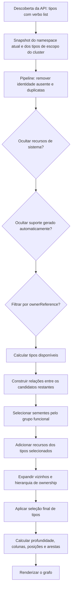

# Como os filtros do dashboard funcionam

O dashboard lê um snapshot de recursos da API Kubernetes, aplica uma sequência ordenada de filtros e entrega os objetos resultantes ao código de layout. Filtros e expansão de relações não fazem novas chamadas à API; somente a atualização do snapshot busca dados novamente.

## Fluxo de dados

Os dois filtros de owner reference são estágios separados, ambos posicionados antes da construção das relações. Quando os dois estão ativos simultaneamente, um mantém somente objetos sem owner reference e o outro mantém somente objetos com owner reference; portanto, nenhum objeto passa por ambos.

## Fonte e conteúdo do snapshot

`ResourceGraphService` consulta `/api` e `/apis`, mantém os tipos anunciados com o verbo `list` e lista os objetos em páginas de até 500 itens, com até seis tipos consultados em paralelo. Tipos namespaced são consultados no namespace selecionado. Tipos de escopo do cluster são consultados sem namespace. `Namespace` é representado pelo nó de contexto do grafo e não é listado como um recurso comum nessa consulta.

O snapshot contém os campos usados pelo dashboard: kind, nome, namespace, UID, versão da API, status resumido, labels, owner references, referências reconhecidas, seletores, composições de Pods, finalizers e indicadores de recurso gerenciado pelo Kubernetes ou por owner reference. O conteúdo de Secret não participa do snapshot do grafo. Falhas de listagem são registradas por tipo e não anulam os resultados dos demais tipos.

## Estágios do Template Method

`DashboardResourceGraphFilterManager.Apply` coordena a execução dos estágios em `src/Services/DashboardResourceGraphFilters/DashboardResourceGraphFilterManager.cs`. O contexto e os modelos de entrada/saída da pipeline ficam em `Pipelines/`; o contrato dos estágios, os filtros concretos e o classificador ficam em `Stages/`, cada um em seu próprio arquivo. O manager fixa a sequência e cada comportamento fica encapsulado em um estágio, seguindo o `EntitySaveChangesPipeline` de referência.

1. **Identidade:** descarta objetos sem UID e remove UIDs duplicados.
2. **Sistema Kubernetes:** quando ativo, remove recursos de namespaces de sistema, recursos marcados pela anotação `kubernetes.io/created-by` e kinds de sistema definidos pela política.
3. **Suporte gerado:** quando ativo, remove os kinds auxiliares configurados, como Event, Endpoint, EndpointSlice, Lease, métricas e VolumeAttachment, além do Service `kubernetes` no namespace `default`.
4. **Owner references:** os estágios independentes podem remover objetos com owner reference ou objetos sem owner reference.
5. **Tipos disponíveis:** coleta os kinds restantes após os estágios de visibilidade. O grupo funcional não reduz essa lista.
6. **Relações:** constrói edges de ownership, seletores, referências, agendamento, labels relacionadas e outros campos reconhecidos.
7. **Grupo funcional:** escolhe os recursos iniciais do grupo. Por exemplo, Infrastructure inclui Node e RuntimeClass; Deployment, StatefulSet e Pod pertencem a Workloads.
8. **Tipos explícitos:** tipos escolhidos no seletor também iniciam o escopo, mesmo quando pertencem a outro grupo funcional.
9. **Expansão:** inclui relações adjacentes, a cadeia de owners e dependentes da hierarquia de ownership.
10. **Saída por tipo:** se houver tipos selecionados, mantém no resultado apenas os kinds escolhidos.

Os estágios atuais ficam definidos no array `Stages` do manager em `src/Services/DashboardResourceGraphFilters/DashboardResourceGraphFilterManager.cs`. `Home.razor` fornece opções, guarda preferências e transforma o resultado filtrado em posições, colunas, nós de composição e arestas para renderização.

## Como interpretar os controles

- **Grupo funcional:** define os recursos iniciais quando nenhum kind está selecionado. As relações podem fazer aparecer recursos relacionados de outros grupos.
- **Tipos de recurso visíveis:** oferece os kinds que sobraram dos filtros de visibilidade. Ao selecionar tipos, eles podem ser mostrados independentemente do grupo funcional.
- **Recursos de sistema:** também considera namespaces `kube-system`, `kube-public` e `kube-node-lease`, além de kinds de sistema e da anotação de criação pelo Kubernetes.
- **Suporte gerado automaticamente:** usa uma lista de kinds de suporte e uma regra para o Service `kubernetes`; não é um detector universal de objetos gerados.
- **Com owner reference:** significa que o objeto declara pelo menos uma owner reference; o nome do controle não comprova que o owner foi carregado ou que a relação seja um par controlador conhecido.
- **Contagem do grafo:** conta os nós de layout menos os dois nós-raiz de contexto. Composições de Pods, como containers e volumes, também podem entrar nessa contagem.

## Relações que podem expandir um grupo

O grupo funcional seleciona sementes; depois as relações podem incluir contexto de outros grupos. Um Node pode se ligar a um Pod pela propriedade `spec.nodeName`; pela cadeia de owner references, o Pod pode levar a ReplicaSet e Deployment. Assim, ao selecionar Infrastructure, é possível ver workloads relacionados sem que Deployment pertença ao grupo Infrastructure.

As relações são baseadas em evidências observadas nos objetos, como `metadata.ownerReferences`, seletores e campos de referência reconhecidos. Relações não reconhecidas, objetos ausentes por RBAC e alvos fora do snapshot não criam nós substitutos.
