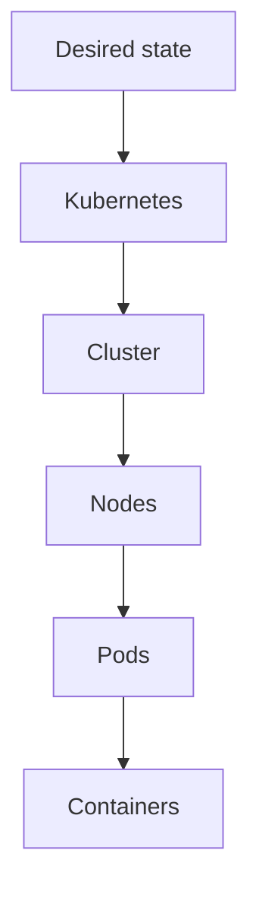
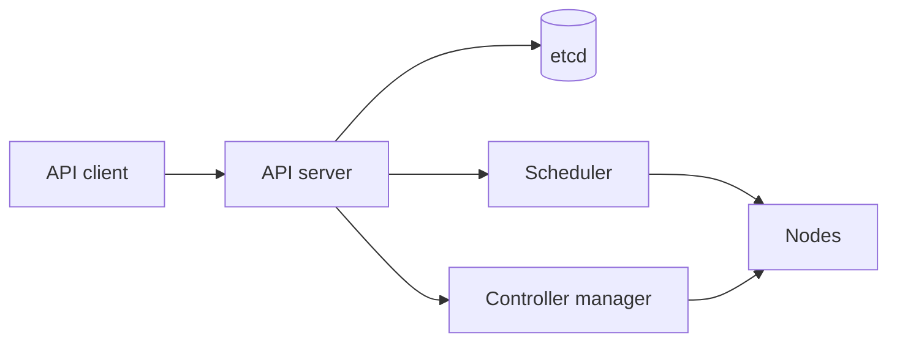
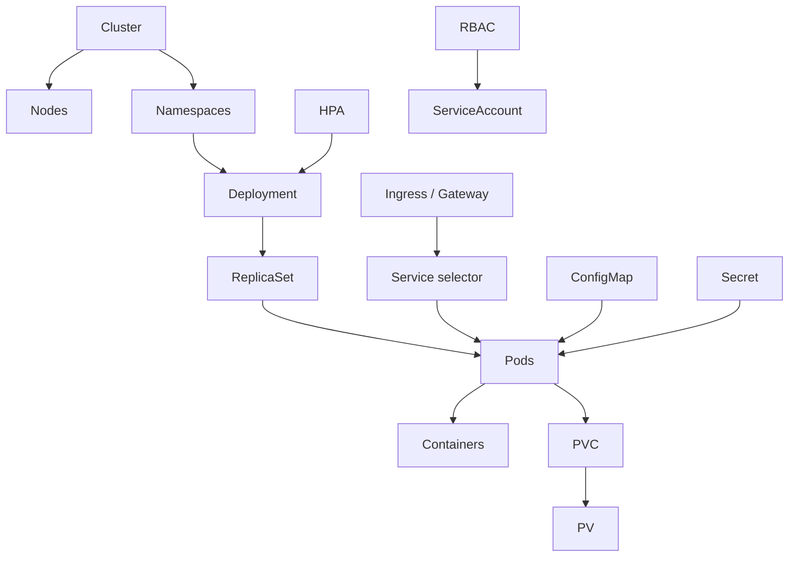
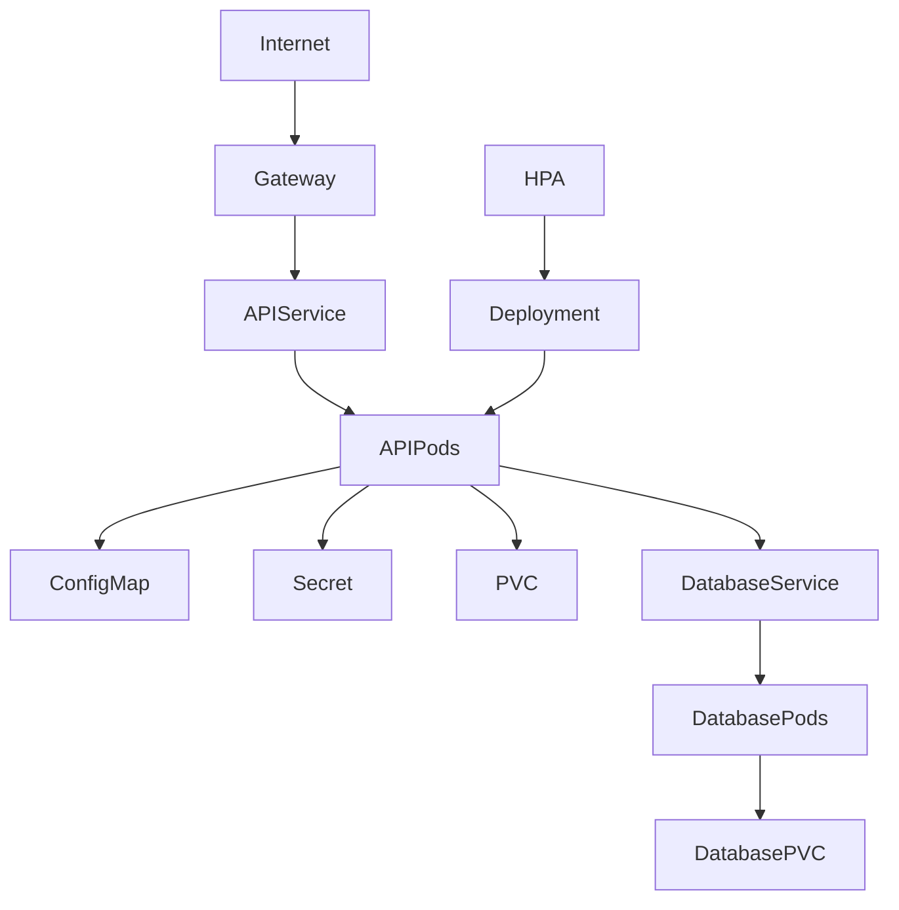
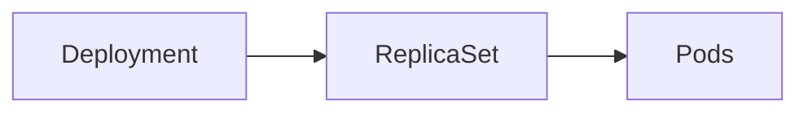
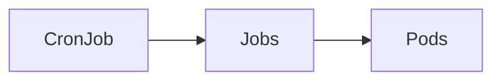
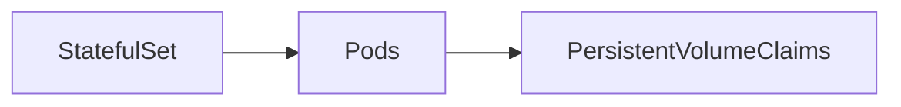
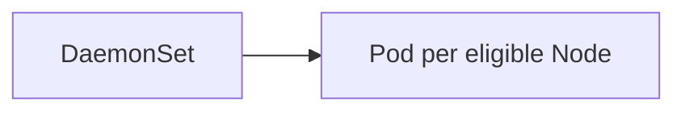

# Kubernetes — Fundamentals and Advanced Concepts

This local guide explains the Kubernetes concepts shown in the visualizer. It covers cluster architecture, workloads, networking, storage, scheduling, security, extensibility, and operations.

## 1. Overview

Kubernetes runs and manages containerized applications declaratively. You describe the desired state; Kubernetes controllers observe the actual state and work to make it converge. Keep two ideas separate: **hierarchy** describes ownership and composition; **relationships** describe resources that select, reference, or control other resources.



## 2. Cluster

A cluster is the complete Kubernetes environment: its control plane, worker nodes, namespaces, workloads, networking, storage, policies, and configuration. It is the context in which Kubernetes resources exist.

## 3. Control plane

The control plane manages the cluster. Its main components are the API server, etcd, scheduler, and controller manager. The API server is the entry point for clients; etcd stores cluster state; the scheduler assigns Pods to nodes; controllers keep observed state close to desired state.



## 4. Worker node

A Node is a physical or virtual machine that runs workloads. The kubelet communicates with the API server, the container runtime runs containers, and networking components route traffic. A Pod is scheduled onto a Node, but it should not be treated as permanently bound to that machine.

## 5. Namespace

A Namespace logically partitions namespaced resources inside a cluster. Teams often use namespaces to separate environments, apply policies, and set quotas. A Namespace is not a machine or virtual machine; one Node can run Pods from several namespaces.

```yaml
apiVersion: v1
kind: Namespace
metadata:
  name: development
```

## 6. Workloads

A workload is an application or process Kubernetes must run. Common workload resources are Deployment, StatefulSet, DaemonSet, Job, and CronJob. Each expresses a different lifecycle and scheduling model.

## 7. Deployment

A Deployment manages stateless applications. It declares the desired replica count and Pod template, then creates and updates ReplicaSets. A rolling update replaces Pods gradually while the controller works toward the declared state.

```yaml
apiVersion: apps/v1
kind: Deployment
metadata:
  name: api
spec:
  replicas: 3
  selector:
    matchLabels:
      app: api
  template:
    metadata:
      labels:
        app: api
    spec:
      containers:
        - name: api
          image: example/api:1.0
```

## 8. ReplicaSet

A ReplicaSet keeps a requested number of matching Pods running. Deployments normally manage ReplicaSets, so applications are usually changed through a Deployment rather than by editing its ReplicaSet directly.

## 9. Pod

A Pod is Kubernetes' smallest deployable unit. It contains one or more containers that share a network identity and can share volumes. Most Pods have one main application container; sidecars are also common. A Pod is scheduled and replaced as a unit.

## 10. Containers

A container is a process running inside a Pod. Kubernetes schedules Pods, not individual containers. Containers in one Pod share the Pod network and may mount the same volumes.

## 11. Labels and selectors

Labels are key/value metadata attached to objects. Selectors choose objects whose labels match a rule. A label shared by two resources does not itself create a Kubernetes dependency; a resource such as a Service or Deployment must use a matching selector for the label to affect behavior.

```yaml
metadata:
  labels:
    app: api
    environment: production
```

## 12. Service

Pod addresses can change when Pods are replaced. A Service gives clients a stable address and selects backend Pods by labels. Common types are ClusterIP, NodePort, LoadBalancer, and ExternalName. The selector-to-Pod association is distinct from ownership.

## 13. Ingress and Gateway API

Ingress and Gateway API describe HTTP/HTTPS entry points and route traffic to Services. Ingress is the older, simpler API. Gateway API offers richer role separation and routing features. Neither replaces the Service that provides a stable backend.

## 14. ConfigMap

A ConfigMap stores non-sensitive configuration. Pods can consume its keys as environment variables or mounted files. Do not store passwords, tokens, or private keys in a ConfigMap.

## 15. Secret

A Secret represents sensitive values such as passwords, tokens, certificates, and connection strings. Base64 encoding in the API representation is not encryption. Protection depends on RBAC, transport security, and the cluster's storage encryption configuration. This app hides Secret values by default and only requests them after an explicit reveal action.

### External secret stores

A Kubernetes Secret is stored in the cluster; Base64 is encoding, not encryption. Restrict access with RBAC and configure encryption at rest. To keep the value source outside the cluster, install an operator or driver and configure its identity and provider permissions.

#### External Secrets Operator

The [External Secrets Operator](https://external-secrets.io/latest/) reads an external store and synchronizes values into a Kubernetes Secret. It fits applications that consume Secrets through environment variables or volumes. It requires the operator, a configured SecretStore/ClusterSecretStore, and permissions to read the provider and create/update the Secret.

```yaml
apiVersion: external-secrets.io/v1
kind: ExternalSecret
metadata:
  name: payments-db
  namespace: platform
spec:
  refreshInterval: 1h
  secretStoreRef:
    name: production-secrets
    kind: ClusterSecretStore
  target:
    name: payments-db
    creationPolicy: Owner
  data:
    - secretKey: password
      remoteRef:
        key: apps/payments
        property: database-password
```

This assumes the store, operator identity, and remote key are configured. ExternalSecret creates or refreshes `payments-db`, which a [Deployment](#deployment) can consume.

#### Secrets Store CSI Driver

The [Secrets Store CSI Driver](https://secrets-store-csi-driver.sigs.k8s.io/) mounts provider values as files in a Pod through a SecretProviderClass. It fits applications that read files and policies that aim to avoid an API-server Secret copy. It requires the driver and provider plugin, an authorized Pod identity, and mount configuration.

```yaml
apiVersion: secrets-store.csi.x-k8s.io/v1
kind: SecretProviderClass
metadata:
  name: payments-db
  namespace: platform
spec:
  provider: vault
  parameters:
    roleName: payments
    objects: |
      - objectName: database-password
        secretPath: secret/data/apps/payments
        secretKey: password
---
apiVersion: apps/v1
kind: Deployment
metadata:
  name: payments
  namespace: platform
spec:
  selector:
    matchLabels: { app: payments }
  template:
    metadata:
      labels: { app: payments }
    spec:
      containers:
        - name: app
          image: example/payments:1.0
          volumeMounts:
            - name: external-secrets
              mountPath: /mnt/secrets-store
              readOnly: true
      volumes:
        - name: external-secrets
          csi:
            driver: secrets-store.csi.k8s.io
            readOnly: true
            volumeAttributes:
              secretProviderClass: payments-db
```

The Vault excerpt requires the Vault plugin and configured authentication. Syncing CSI files into Kubernetes Secrets is optional and creates a cluster-side copy; enable it only if needed. Check the driver documentation for support and rotation in the installed version.

**Choose:** native Secret is simplest; ESO synchronizes an external store into the Secret model; CSI mounts files without creating that copy by default. None replaces least-privilege RBAC, rotation, and encryption at rest.

References: [Kubernetes Secrets](https://kubernetes.io/docs/concepts/configuration/secret/), [encryption at rest](https://kubernetes.io/docs/tasks/administer-cluster/encrypt-data/), [ExternalSecret API](https://external-secrets.io/latest/api/externalsecret/), and [CSI driver usage](https://secrets-store-csi-driver.sigs.k8s.io/getting-started/usage).

## 16. Storage

Persistent storage separates data lifetime from Pod lifetime. A Pod can request storage through a PersistentVolumeClaim; the claim can bind to a PersistentVolume, which represents capacity made available to the cluster.

```text
Pod → PersistentVolumeClaim → PersistentVolume → storage backend
```

## 17. PersistentVolumeClaim

A PersistentVolumeClaim (PVC) is an application's request for storage capacity and access modes. A Pod mounts the claim instead of depending on a specific storage device.

```yaml
apiVersion: v1
kind: PersistentVolumeClaim
metadata:
  name: database-data
spec:
  accessModes: [ReadWriteOnce]
  resources:
    requests:
      storage: 20Gi
```

## 18. PersistentVolume

A PersistentVolume (PV) represents storage capacity in the cluster. It may be provisioned in advance or dynamically for a claim. Its implementation connects Kubernetes to a storage backend.

## 19. StorageClass

A StorageClass describes a class of dynamically provisioned storage. A PVC can name a class; a provisioner then creates a matching PV according to that class's parameters and policies.

## 20. StatefulSet

A StatefulSet manages Pods that need stable identities or storage associated with each replica. Names such as `database-0` and `database-1` remain predictable across replacement. Stateful workloads often need ordered startup and shutdown.

## 21. DaemonSet

A DaemonSet schedules a Pod onto every eligible Node, or onto Nodes matching its scheduling rules. Typical uses include logging, monitoring, networking, and security agents.

## 22. Job and CronJob

A Job runs work that should complete, such as a migration or batch task. A CronJob creates Jobs on a schedule. Jobs and their Pods remain separate resources, connected through ownership.

## 23. Requests and limits

Requests describe the CPU and memory a container asks the scheduler to reserve. Limits cap the resources it may consume. Requests affect placement; limits affect runtime enforcement.

```yaml
resources:
  requests:
    cpu: 250m
    memory: 256Mi
  limits:
    cpu: 500m
    memory: 512Mi
```

## 24. Scheduling

The scheduler chooses a Node for each unscheduled Pod. It considers resource requests, node availability, affinity rules, taints and tolerations, topology constraints, and other policies. A Pod can remain Pending when no eligible Node is available.

## 25. Node affinity

Node affinity expresses required or preferred Node labels for a Pod. Required rules constrain placement; preferred rules guide the scheduler without making a matching Node mandatory.

## 26. Pod anti-affinity

Pod anti-affinity can keep related Pods apart, for example by spreading replicas across Nodes. This can reduce the effect of a single machine failure, subject to available capacity and topology rules.

## 27. Taints and tolerations

A taint marks a Node so that Pods without a matching toleration are not scheduled there, or may be evicted. A toleration allows a Pod to be considered; it does not by itself force placement on that Node.

## 28. Topology spread constraints

Topology spread constraints distribute Pods across failure domains such as Nodes or zones. They help avoid concentrating all replicas in one domain, subject to the configured skew and scheduling constraints.

## 29. Health probes

Startup probes allow slow applications time to initialize. Readiness probes determine whether a container should receive traffic. Liveness probes detect a process that should be restarted. These probes answer different questions and should be configured for the application's behavior.

## 30. Horizontal Pod Autoscaler

The Horizontal Pod Autoscaler (HPA) adjusts a workload's replica count using resource or custom metrics. It needs usable metrics and a scalable target. It adds or removes Pods; it does not resize the resources allocated to each Pod.

## 31. Vertical Pod Autoscaler

The Vertical Pod Autoscaler (VPA) recommends or adjusts CPU and memory requests for Pods. Depending on its mode, applying a recommendation can require Pod replacement. HPA changes the number of Pods; VPA changes per-Pod resource sizing.

## 32. PodDisruptionBudget

A PodDisruptionBudget (PDB) limits voluntary disruptions so a minimum number or percentage of selected Pods remains available. It affects operations such as draining a Node; it does not prevent involuntary failures.

## 33. PriorityClass

A PriorityClass assigns relative scheduling priority to Pods. When resources are scarce, higher-priority Pods may be scheduled before lower-priority Pods, and preemption may remove lower-priority workloads when allowed.

## 34. ServiceAccount

A ServiceAccount is an identity that a Pod can use when calling the Kubernetes API. Its effective permissions come from authorization rules such as RoleBindings and ClusterRoleBindings, not from the ServiceAccount object alone.

## 35. RBAC

Role-based access control (RBAC) grants verbs such as `get`, `list`, `watch`, `create`, `patch`, and `delete` on specified resources and scopes. Roles and RoleBindings are namespace-scoped; ClusterRoles and ClusterRoleBindings can grant cluster-wide permissions.

## 36. SecurityContext

A SecurityContext configures process and container security, including user and group IDs, Linux capabilities, privilege escalation, and read-only filesystems. Pod-level and container-level settings can have different scope.

## 37. NetworkPolicy

A NetworkPolicy selects Pods and describes allowed ingress or egress traffic. Enforcement depends on a network plugin that supports NetworkPolicy. Policies are additive, and their effect depends on the selected Pods and namespace.

## 38. ResourceQuota

A ResourceQuota limits aggregate resource consumption or object counts within a Namespace. It can constrain CPU, memory, storage, and the number of selected resource types.

## 39. LimitRange

A LimitRange sets per-object minimums, maximums, or defaults for resources in a Namespace. ResourceQuota limits the namespace total; LimitRange governs individual Pods, containers, or claims.

## 40. CustomResourceDefinition

A CustomResourceDefinition (CRD) adds a new kind to the Kubernetes API. Once installed, users can create custom resources that follow the CRD schema. A CRD defines a type; an operator or controller usually implements its behavior.

```yaml
apiVersion: example.com/v1
kind: Database
metadata:
  name: primary
spec:
  version: "17"
```

## 41. Controller

A controller watches API objects and repeatedly compares desired state with observed state. It takes actions to reduce the difference. Controllers are the mechanism behind Deployments, StatefulSets, and many other Kubernetes features.

## 42. Operator

An Operator combines CRDs and controllers with application-specific operational knowledge. It can automate tasks such as provisioning, backup, recovery, replication, and upgrades for a particular system.

## 43. Admission controllers

Admission controllers inspect API requests after authentication and authorization but before persistence. They can validate, mutate, or reject objects. They are commonly used to enforce policy and set safe defaults.

## 44. Helm

Helm packages Kubernetes manifests into Charts with templates and configurable values. It manages releases and rendered resources; it does not replace Kubernetes controllers or guarantee that an application is healthy.

## 45. Kustomize

Kustomize composes and customizes Kubernetes manifests without requiring a template language. A common layout has a reusable base and environment-specific overlays such as development, staging, and production.

## 46. Argo CD and GitOps

GitOps treats a version-controlled repository as a source of desired configuration. Argo CD compares repository state with cluster state and reconciles differences according to its configuration. The visualizer displays resources; it does not perform GitOps synchronization.

## 47. Observability

Observability combines logs, metrics, traces, and events to understand system behavior. Kubernetes events describe notable object and control-plane activity; application logs describe process output. Metrics and traces require their own collection systems.

## 48. How the concepts fit together

Workloads create and manage Pods. Services select Pods to provide stable networking. Ingress or Gateway routes traffic to Services. Pods consume configuration and storage; policies constrain their access; schedulers place them on Nodes. These links have different meanings and should not all be read as ownership.



## 49. A useful mental model

Start with structural ownership: a Deployment owns ReplicaSets, and ReplicaSets own Pods. Then add other relationships: Services select Pods; routes point to Services; Pods reference configuration, identities, and claims; policies select workloads. Shared labels can help visualize an association, but a label match alone does not prove that one resource depends on another.

## 50. A typical application architecture

A .NET application might use a Gateway or Ingress to route requests to an API Service. That Service selects API Pods managed by a Deployment. The Pods consume ConfigMaps and Secrets, mount a PVC, and connect to a database Service backed by a StatefulSet and persistent storage. An HPA can adjust the Deployment's replica count, while a PDB limits voluntary disruption.



## 51. Recommended learning order

### Level 1 — Structure
Cluster, Control Plane, Node, Namespace, Pod, and Container.

### Level 2 — Workloads
Deployment, ReplicaSet, StatefulSet, DaemonSet, Job, and CronJob.

### Level 3 — Communication
Labels, selectors, Services, Ingress, and Gateway API.

### Level 4 — Configuration and data
ConfigMap, Secret, Volume, PVC, PV, and StorageClass.

### Level 5 — Scheduling and resources
Requests, limits, Scheduler, affinity, anti-affinity, taints, tolerations, and topology spread constraints.

### Level 6 — Resilience and scaling
Probes, HPA, VPA, PDB, and PriorityClass.

### Level 7 — Security
ServiceAccount, RBAC, SecurityContext, NetworkPolicy, ResourceQuota, and LimitRange.

### Level 8 — Extensibility
CRDs, controllers, operators, and admission controllers.

### Level 9 — Delivery and operations
Helm, Kustomize, Argo CD, GitOps, and observability.

## 52. Summary

```text
CLUSTER
├── CONTROL PLANE: API Server, Scheduler, Controllers, etcd
├── NODES: run Pods, which run Containers
└── NAMESPACES: contain workloads and namespaced resources
    └── DEPLOYMENT → REPLICASET → PODS → CONTAINERS

CROSS-CUTTING RELATIONSHIPS
SERVICE → selects PODS
INGRESS / GATEWAY → routes to SERVICES
CONFIGMAP / SECRET → configure PODS
PVC / PV / STORAGECLASS → provide STORAGE
HPA / VPA / PDB → influence WORKLOAD behavior
SCHEDULER → places PODS on NODES
RBAC / SERVICEACCOUNT → control permissions
NETWORKPOLICY → controls network traffic
CRD / OPERATOR → extend Kubernetes
HELM / KUSTOMIZE / ARGO CD → package, configure, and deliver resources
```

Keep the distinction between structure and relationships: Cluster is the broadest context; Nodes and Namespaces belong to it; workloads in Namespaces create Pods; Pods run Containers. Many other resources point to, select, configure, or constrain these objects rather than forming ownership hierarchy.

# Practical examples and comparisons

The Wiki's **Practical examples** sections contain fuller translated examples with copy buttons. Names and images below are illustrative; check your cluster's controllers and StorageClasses before applying manifests.

## Deployment vs StatefulSet vs DaemonSet

Use a Deployment for interchangeable replicas. StatefulSet provides ordinal identity and can create one PVC per replica; it does not replicate data or make an application highly available by itself. DaemonSet runs on each eligible Node. Use Job for finite work and CronJob to create Jobs on a schedule. A ReplicaSet is normally managed by a Deployment.

```yaml
apiVersion: apps/v1
kind: Deployment
metadata: { name: api }
spec:
  replicas: 3
  selector: { matchLabels: { app: api } }
  template:
    metadata: { labels: { app: api } }
    spec:
      containers: [{ name: api, image: example/api:1.0 }]
```

References: [Deployment](https://kubernetes.io/docs/concepts/workloads/controllers/deployment/), [StatefulSet](https://kubernetes.io/docs/concepts/workloads/controllers/statefulset/), [DaemonSet](https://kubernetes.io/docs/concepts/workloads/controllers/daemonset/), and [Jobs](https://kubernetes.io/docs/concepts/workloads/controllers/).

## Service, Ingress, and Gateway API

A Service provides a stable address and selects Pods by labels. Ingress/Gateway define external routes to Services. Ingress needs a controller; its API is frozen, and Kubernetes recommends considering Gateway API for new routing features.

```yaml
apiVersion: v1
kind: Service
metadata: { name: web }
spec:
  selector: { app: web }
  ports: [{ port: 80, targetPort: 8080 }]
```

References: [Service](https://kubernetes.io/docs/concepts/services-networking/service/), [Ingress](https://kubernetes.io/docs/concepts/services-networking/ingress/), and [Gateway API](https://gateway-api.sigs.k8s.io/).

## Configuration, identity, and permissions

A ConfigMap stores non-sensitive settings; a Secret represents sensitive data, but Base64 is not encryption. A ServiceAccount identifies a Pod. Role/ClusterRole define permissions; RoleBinding/ClusterRoleBinding associate subjects with roles.

```yaml
apiVersion: v1
kind: ConfigMap
metadata: { name: api-config }
data: { LOG_LEVEL: Information }
---
apiVersion: v1
kind: Secret
metadata: { name: api-credentials }
type: Opaque
stringData: { password: replace-me }
```

Use fictional credentials in examples. References: [ConfigMap](https://kubernetes.io/docs/concepts/configuration/configmap/), [Secret](https://kubernetes.io/docs/concepts/configuration/secret/), [ServiceAccount](https://kubernetes.io/docs/concepts/security/service-accounts/), and [RBAC](https://kubernetes.io/docs/reference/access-authn-authz/rbac/).

## PVC, PV, and StorageClass

Applications request storage with a PVC. The cluster binds the claim to an existing PV or provisions one dynamically according to a StorageClass. Users usually create PVCs; administrators and provisioners manage PVs. Local volumes depend on a specific Node.

```yaml
apiVersion: v1
kind: PersistentVolumeClaim
metadata: { name: app-data }
spec:
  accessModes: [ReadWriteOnce]
  resources:
    requests: { storage: 5Gi }
```

References: [Persistent Volumes](https://kubernetes.io/docs/concepts/storage/persistent-volumes/), [StorageClass](https://kubernetes.io/docs/concepts/storage/storage-classes/), and [dynamic provisioning](https://kubernetes.io/docs/concepts/storage/dynamic-provisioning/).

## Scaling, health, and availability

HPA changes replica count based on metrics; VPA recommends or changes per-Pod requests/limits and is usually installed separately; PDB limits voluntary disruptions. Requests/limits and probes configure a container/Pod; they are not controller resources.

```yaml
apiVersion: autoscaling/v2
kind: HorizontalPodAutoscaler
metadata: { name: api }
spec:
  scaleTargetRef: { apiVersion: apps/v1, kind: Deployment, name: api }
  minReplicas: 2
  maxReplicas: 8
  metrics:
    - type: Resource
      resource:
        name: cpu
        target: { type: Utilization, averageUtilization: 70 }
```

References: [HPA](https://kubernetes.io/docs/tasks/run-application/horizontal-pod-autoscale/), [probes](https://kubernetes.io/docs/concepts/workloads/pods/pod-lifecycle/#container-probes), [disruptions/PDB](https://kubernetes.io/docs/concepts/workloads/pods/disruptions/), and [VPA](https://github.com/kubernetes/autoscaler/tree/master/vertical-pod-autoscaler).

## Policies and scheduling

NetworkPolicy selects Pods and requires a plugin that enforces it. ResourceQuota limits namespace totals; LimitRange sets per-object defaults and bounds. PriorityClass affects scheduling priority; affinity, taints/tolerations, and topology spread influence Pod placement.

```yaml
apiVersion: v1
kind: ResourceQuota
metadata: { name: team-budget }
spec:
  hard: { pods: "20", requests.cpu: "4", requests.memory: 8Gi }
```

References: [NetworkPolicy](https://kubernetes.io/docs/concepts/services-networking/network-policies/), [ResourceQuota](https://kubernetes.io/docs/concepts/policy/resource-quotas/), [LimitRange](https://kubernetes.io/docs/concepts/policy/limit-range/), and [scheduling](https://kubernetes.io/docs/concepts/scheduling-eviction/).

## Extensibility and delivery

A CRD adds an API type; a controller/Operator implements its behavior. Helm packages templates, Kustomize composes overlays, and Argo CD reconciles manifests from Git. These tools have different roles and do not replace Deployment/StatefulSet.

```yaml
apiVersion: apiextensions.k8s.io/v1
kind: CustomResourceDefinition
metadata: { name: databases.example.com }
spec:
  group: example.com
  scope: Namespaced
  names: { plural: databases, singular: database, kind: Database }
  versions:
    - name: v1
      served: true
      storage: true
      schema:
        openAPIV3Schema:
          type: object
          properties:
            spec: { type: object }
```

References: [Custom Resources/CRD](https://kubernetes.io/docs/concepts/extend-kubernetes/api-extension/custom-resources/), [Helm](https://helm.sh/docs/), [Kustomize](https://kubectl.docs.kubernetes.io/references/kustomize/), and [Argo CD](https://argo-cd.readthedocs.io/).

## Namespace, Pod, ReplicaSet, labels, and selectors

A Namespace separates names and policies; a Pod is the executable unit; a ReplicaSet maintains selected Pods but should usually be managed by a Deployment. Labels are metadata and only affect behavior when a selector uses them.

Clusters and Nodes appear in the graph, but their creation depends on the distribution and infrastructure provider; there is no portable application manifest to create them in every environment. Check your provider's docs and the Kubernetes [Nodes guide](https://kubernetes.io/docs/concepts/architecture/nodes/).

```yaml
apiVersion: v1
kind: Namespace
metadata: { name: team-a }
---
apiVersion: apps/v1
kind: ReplicaSet
metadata:
  name: api-example
  namespace: team-a
spec:
  replicas: 2
  selector: { matchLabels: { app: api } }
  template:
    metadata: { labels: { app: api } }
    spec:
      containers: [{ name: api, image: example/api:1.0 }]
```

References: [Namespaces](https://kubernetes.io/docs/concepts/overview/working-with-objects/namespaces/), [Pods](https://kubernetes.io/docs/concepts/workloads/pods/), [ReplicaSets](https://kubernetes.io/docs/concepts/workloads/controllers/replicaset/), and [labels/selectors](https://kubernetes.io/docs/concepts/overview/working-with-objects/labels/).

## PriorityClass and placement rules

PriorityClass ranks Pods relative to each other; it does not reserve capacity. Affinity and topology spread guide or constrain placement; tolerations allow a Pod to tolerate taints without forcing a specific Node.

```yaml
apiVersion: scheduling.k8s.io/v1
kind: PriorityClass
metadata: { name: batch-low }
value: 1000
globalDefault: false
description: Low-priority batch workloads
```

References: [PriorityClass](https://kubernetes.io/docs/concepts/scheduling-eviction/pod-priority-preemption/), [Node affinity](https://kubernetes.io/docs/concepts/scheduling-eviction/assign-pod-node/), and [topology spread](https://kubernetes.io/docs/concepts/scheduling-eviction/topology-spread-constraints/).

## Packaging and delivery commands

```bash
helm upgrade --install api ./chart --namespace team-a --create-namespace
kubectl apply -k ./overlays/dev
argocd app get api-team-a
```

The first command installs/upgrades a release; the second applies a Kustomize overlay; the third reads an already configured Argo CD Application. Review changes before syncing GitOps.

## Resource creation examples

Use these examples as starting points and adapt names, images, storage classes, controller-specific fields, and permissions to your cluster.

### [Cluster](/wiki#cluster)

```bash
kubectl config current-context
kubectl cluster-info
kubectl get nodes
```

### [Node](/wiki#worker-node)

```bash
kubectl get nodes -o wide
kubectl describe node <node-name>
```

### [Namespace](/wiki#namespace)

```yaml
apiVersion: v1
kind: Namespace
metadata:
  name: demo
```

### [Containers](/wiki#containers)

```yaml
apiVersion: v1
kind: Pod
metadata:
  name: app-with-container
spec:
  containers:
    - name: app
      image: nginx:1.27
```

### [Deployment](/wiki#deployment)

```yaml
apiVersion: apps/v1
kind: Deployment
metadata:
  name: api
spec:
  replicas: 3
  selector:
    matchLabels:
      app: api
  template:
    metadata:
      labels:
        app: api
    spec:
      containers:
        - name: api
          image: my-api:1.0
```

### [ReplicaSet](/wiki#replicaset)

```yaml
apiVersion: apps/v1
kind: ReplicaSet
metadata:
  name: api
spec:
  replicas: 2
  selector:
    matchLabels:
      app: api
  template:
    metadata:
      labels:
        app: api
    spec:
      containers:
        - name: api
          image: nginx:1.27
```

### [Pod](/wiki#pod)

```yaml
apiVersion: v1
kind: Pod
metadata:
  name: standalone
  labels:
    app: standalone
spec:
  containers:
    - name: app
      image: nginx:1.27
```

### [Service](/wiki#service)

```yaml
apiVersion: v1
kind: Service
metadata:
  name: web
spec:
  selector:
    app: web
  ports:
    - name: http
      port: 80
      targetPort: 8080
  type: ClusterIP
```

### [Ingress and Gateway API](/wiki#ingress-e-gateway-api)

```yaml
apiVersion: networking.k8s.io/v1
kind: Ingress
metadata:
  name: web
spec:
  ingressClassName: nginx
  rules:
    - host: web.example.test
      http:
        paths:
          - path: /
            pathType: Prefix
            backend:
              service:
                name: web
                port:
                  number: 80
```

```yaml
apiVersion: gateway.networking.k8s.io/v1
kind: Gateway
metadata:
  name: public-gateway
  namespace: demo
spec:
  gatewayClassName: example-gateway-class
  listeners:
    - name: http
      protocol: HTTP
      port: 80
      allowedRoutes:
        namespaces:
          from: Same
---
apiVersion: gateway.networking.k8s.io/v1
kind: HTTPRoute
metadata:
  name: web
  namespace: demo
spec:
  parentRefs:
    - name: public-gateway
  hostnames:
    - web.example.test
  rules:
    - backendRefs:
        - name: web
          port: 80
```

### [ConfigMap](/wiki#configmap)

```yaml
apiVersion: v1
kind: ConfigMap
metadata:
  name: api-config
data:
  ASPNETCORE_ENVIRONMENT: Production
```

### [Secret](/wiki#secret)

```yaml
apiVersion: external-secrets.io/v1
kind: ExternalSecret
metadata:
  name: payments-db
  namespace: platform
spec:
  refreshInterval: 1h
  secretStoreRef:
    name: production-secrets
    kind: ClusterSecretStore
  target:
    name: payments-db
    creationPolicy: Owner
  data:
    - secretKey: password
      remoteRef:
        key: apps/payments
        property: database-password
```

```yaml
apiVersion: secrets-store.csi.x-k8s.io/v1
kind: SecretProviderClass
metadata:
  name: payments-db
  namespace: platform
spec:
  provider: vault
  parameters:
    roleName: payments
    objects: |
      - objectName: database-password
        secretPath: secret/data/apps/payments
        secretKey: password
---
apiVersion: apps/v1
kind: Deployment
metadata:
  name: payments
  namespace: platform
spec:
  selector:
    matchLabels: { app: payments }
  template:
    metadata:
      labels: { app: payments }
    spec:
      containers:
        - name: app
          image: example/payments:1.0
          volumeMounts:
            - name: external-secrets
              mountPath: /mnt/secrets-store
              readOnly: true
      volumes:
        - name: external-secrets
          csi:
            driver: secrets-store.csi.k8s.io
            readOnly: true
            volumeAttributes:
              secretProviderClass: payments-db
```

### [Volume in a Pod](/wiki#storage)

```yaml
apiVersion: v1
kind: Pod
metadata:
  name: app-with-volume
spec:
  containers:
    - name: app
      image: nginx:1.27
      volumeMounts:
        - name: shared-data
          mountPath: /data
  volumes:
    - name: shared-data
      emptyDir: {}
```

### [PersistentVolumeClaim](/wiki#persistentvolumeclaim)

```yaml
apiVersion: v1
kind: PersistentVolumeClaim
metadata:
  name: postgres-data
spec:
  accessModes:
    - ReadWriteOnce
  resources:
    requests:
      storage: 20Gi
```

### [PersistentVolume](/wiki#persistentvolume)

```yaml
apiVersion: v1
kind: PersistentVolume
metadata:
  name: local-data
spec:
  capacity:
    storage: 5Gi
  accessModes:
    - ReadWriteOnce
  persistentVolumeReclaimPolicy: Retain
  hostPath:
    path: /mnt/data
```

### [StorageClass](/wiki#storageclass)

```yaml
apiVersion: storage.k8s.io/v1
kind: StorageClass
metadata:
  name: fast
provisioner: example.com.csi.driver
reclaimPolicy: Delete
volumeBindingMode: WaitForFirstConsumer
```

### [StatefulSet](/wiki#statefulset)

```yaml
apiVersion: v1
kind: Service
metadata:
  name: database
spec:
  clusterIP: None
  selector:
    app: database
  ports:
    - name: db
      port: 5432
      targetPort: 5432
---
apiVersion: apps/v1
kind: StatefulSet
metadata:
  name: database
spec:
  serviceName: database
  replicas: 2
  selector:
    matchLabels:
      app: database
  template:
    metadata:
      labels:
        app: database
    spec:
      containers:
        - name: postgres
          image: postgres:16
          ports:
            - containerPort: 5432
          volumeMounts:
            - name: data
              mountPath: /var/lib/postgresql/data
  volumeClaimTemplates:
    - metadata:
        name: data
      spec:
        accessModes: ["ReadWriteOnce"]
        resources:
          requests:
            storage: 5Gi
```

### [DaemonSet](/wiki#daemonset)

```yaml
apiVersion: apps/v1
kind: DaemonSet
metadata:
  name: node-agent
spec:
  selector:
    matchLabels:
      app: node-agent
  template:
    metadata:
      labels:
        app: node-agent
    spec:
      containers:
        - name: agent
          image: example/node-agent:1.0
```

### [Job and CronJob](/wiki#job-e-cronjob)

```yaml
apiVersion: batch/v1
kind: CronJob
metadata:
  name: cleanup
spec:
  schedule: "0 2 * * *"
  jobTemplate:
    spec:
      template:
        spec:
          restartPolicy: OnFailure
          containers:
            - name: cleanup
              image: busybox:1.36
              command: ["sh", "-c", "echo cleanup"]
```

```yaml
apiVersion: batch/v1
kind: Job
metadata:
  name: one-time-report
spec:
  backoffLimit: 2
  template:
    spec:
      restartPolicy: Never
      containers:
        - name: report
          image: busybox:1.36
          command: ["sh", "-c", "echo generate report"]
```

### [HorizontalPodAutoscaler](/wiki#horizontal-pod-autoscaler-hpa)

```yaml
apiVersion: autoscaling/v2
kind: HorizontalPodAutoscaler
metadata:
  name: web
spec:
  scaleTargetRef:
    apiVersion: apps/v1
    kind: Deployment
    name: web
  minReplicas: 2
  maxReplicas: 10
  metrics:
    - type: Resource
      resource:
        name: cpu
        target:
          type: Utilization
          averageUtilization: 70
```

### [VerticalPodAutoscaler](/wiki#vertical-pod-autoscaler-vpa)

```yaml
apiVersion: autoscaling.k8s.io/v1
kind: VerticalPodAutoscaler
metadata:
  name: web
spec:
  targetRef:
    apiVersion: apps/v1
    kind: Deployment
    name: web
  updatePolicy:
    updateMode: Off
```

### [PodDisruptionBudget](/wiki#poddisruptionbudget-pdb)

```yaml
minAvailable: 2
```

### [PriorityClass](/wiki#priorityclass)

```yaml
apiVersion: scheduling.k8s.io/v1
kind: PriorityClass
metadata:
  name: high-priority
value: 100000
globalDefault: false
description: "Priority for latency-sensitive workloads"
```

### [ServiceAccount](/wiki#serviceaccount)

```yaml
apiVersion: v1
kind: ServiceAccount
metadata:
  name: app-reader
  namespace: demo
```

### [RBAC](/wiki#rbac)

```yaml
apiVersion: rbac.authorization.k8s.io/v1
kind: Role
metadata:
  name: pod-reader
  namespace: demo
rules:
  - apiGroups: [""]
    resources: ["pods"]
    verbs: ["get", "list", "watch"]
---
apiVersion: rbac.authorization.k8s.io/v1
kind: RoleBinding
metadata:
  name: app-pod-reader
  namespace: demo
subjects:
  - kind: ServiceAccount
    name: app-reader
    namespace: demo
roleRef:
  apiGroup: rbac.authorization.k8s.io
  kind: Role
  name: pod-reader
---
apiVersion: rbac.authorization.k8s.io/v1
kind: ClusterRole
metadata:
  name: node-reader
rules:
  - apiGroups: [""]
    resources: ["nodes"]
    verbs: ["get", "list", "watch"]
---
apiVersion: rbac.authorization.k8s.io/v1
kind: ClusterRoleBinding
metadata:
  name: app-node-reader
subjects:
  - kind: ServiceAccount
    name: app-reader
    namespace: demo
roleRef:
  apiGroup: rbac.authorization.k8s.io
  kind: ClusterRole
  name: node-reader
```

### [NetworkPolicy](/wiki#networkpolicy)

```yaml
apiVersion: networking.k8s.io/v1
kind: NetworkPolicy
metadata:
  name: allow-web
  namespace: demo
spec:
  podSelector:
    matchLabels:
      app: web
  policyTypes: [Ingress]
  ingress:
    - from:
        - podSelector:
            matchLabels:
              app: frontend
      ports:
        - protocol: TCP
          port: 8080
```

### [ResourceQuota](/wiki#resourcequota)

```yaml
apiVersion: v1
kind: ResourceQuota
metadata:
  name: compute-budget
  namespace: demo
spec:
  hard:
    requests.cpu: "4"
    requests.memory: 8Gi
    limits.cpu: "8"
    limits.memory: 16Gi
    pods: "20"
```

### [LimitRange](/wiki#limitrange)

```yaml
apiVersion: v1
kind: LimitRange
metadata:
  name: container-defaults
  namespace: demo
spec:
  limits:
    - type: Container
      defaultRequest:
        cpu: 100m
        memory: 128Mi
      default:
        cpu: 500m
        memory: 512Mi
```

### [CustomResourceDefinition](/wiki#crd-custom-resource-definition)

```yaml
apiVersion: example.com/v1
kind: Database
metadata:
  name: postgres
spec:
  version: "17"
```

## Controllers and the resources they create

- [Deployment → ReplicaSet → Pod](/wiki#deployment)



- [CronJob → Job → Pod](/wiki#job-e-cronjob)



- [StatefulSet → Pod + PVC per replica](/wiki#statefulset)



- [DaemonSet → Pod on each eligible Node](/wiki#daemonset)


