# Kubernetes — Fundamentos e Conceitos Avançados
## 1. Visão geral
Kubernetes é uma plataforma para executar e gerenciar aplicações containerizadas de forma declarativa.
A ideia central é descrever **o estado desejado** da aplicação e deixar o Kubernetes responsável por manter o ambiente nesse estado.
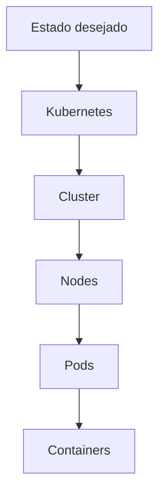
O ponto mais importante para estudar Kubernetes é separar:
- **hierarquia**: quem contém ou agrupa quem;
- **relações**: recursos que apontam, selecionam ou controlam outros recursos.
***
# 2. Cluster
O **Cluster** é o nível mais alto da arquitetura Kubernetes.
Ele representa todo o ambiente gerenciado pelo Kubernetes.
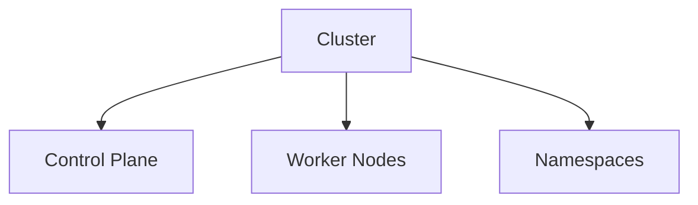
Um cluster normalmente possui:
- Control Plane
- Worker Nodes
- Namespaces
- workloads
- networking
- storage
- políticas
- configurações
O cluster é o contexto dentro do qual os demais recursos Kubernetes existem.
***
# 3. Control Plane
O **Control Plane** é responsável por controlar o cluster.
Principais componentes:
- API Server
- Scheduler
- Controller Manager
- etcd
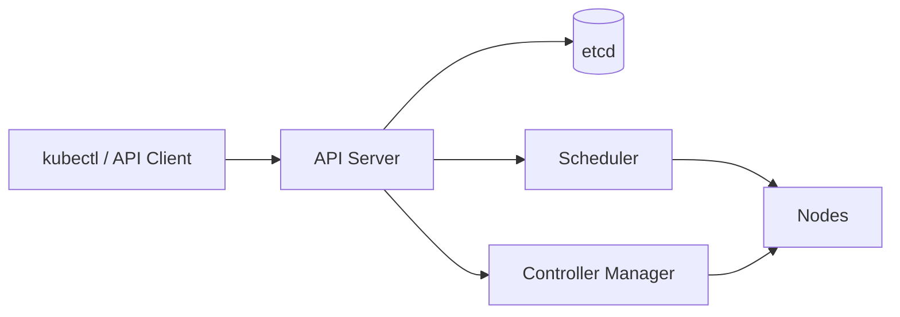
### API Server
É a porta de entrada da API do Kubernetes.
Comandos como:
```bash
kubectl get pods
kubectl apply -f deployment.yaml
```
interagem com o API Server.
### etcd
Banco distribuído usado para armazenar o estado do cluster.
### Scheduler
Decide em qual Node um Pod será executado.
### Controller Manager
Executa controllers que observam o estado atual e tentam aproximá-lo do estado desejado.
***
# 4. Worker Node
Um **Node** é uma máquina que executa workloads.
Pode ser uma máquina física ou virtual.
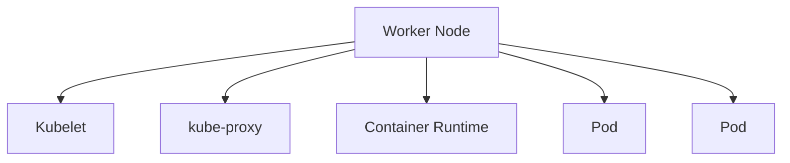
Principais componentes:
- kubelet
- container runtime
- kube-proxy
Um Node executa Pods, mas normalmente não se deve pensar em Pods como pertencentes permanentemente a um Node. O Scheduler pode colocá-los em Nodes diferentes conforme as regras do cluster.
***
# 5. Namespace
**Namespace** é uma forma de dividir logicamente os recursos dentro de um Cluster.
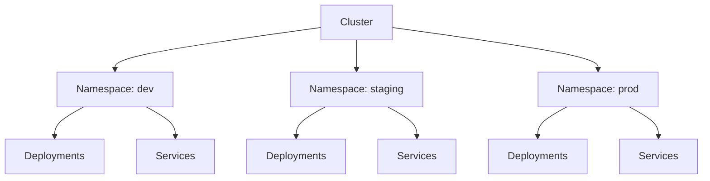
Exemplo:
```bash
kubectl create namespace dev
kubectl get pods -n dev
```
Namespaces são úteis para:
- separar ambientes;
- separar times;
- aplicar políticas;
- controlar quotas;
- organizar recursos.
Importante:
> Namespace não é um Node e não é uma máquina virtual.
Um mesmo Node pode executar Pods pertencentes a vários Namespaces.
***
# 6. Workloads
**Workload** é uma aplicação ou processo que o Kubernetes precisa executar.
Os principais recursos de workload são:
- Deployment
- StatefulSet
- DaemonSet
- Job
- CronJob
A relação geral é:
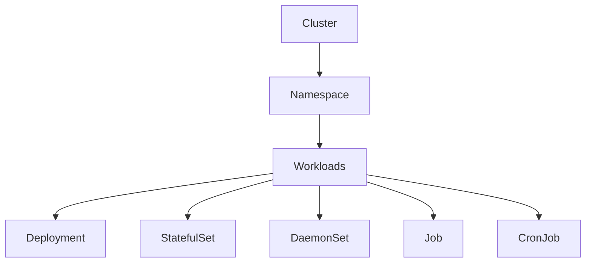
***
# 7. Deployment
Deployment é o principal recurso para aplicações **stateless**.
Ele define quantas réplicas devem existir e qual versão da aplicação deve ser executada.
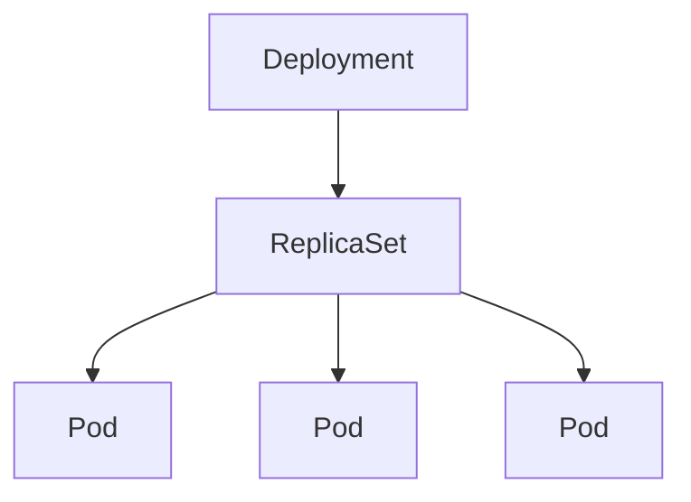
Exemplo:
```yaml
apiVersion: apps/v1
kind: Deployment
metadata:
  name: api
spec:
  replicas: 3
  selector:
    matchLabels:
      app: api
  template:
    metadata:
      labels:
        app: api
    spec:
      containers:
        - name: api
          image: my-api:1.0
```
O Deployment normalmente cria e gerencia um ReplicaSet, que por sua vez mantém os Pods.
***
# 8. ReplicaSet
ReplicaSet garante que determinada quantidade de Pods esteja disponível.
```text
Deployment
    |
    v
ReplicaSet
    |
    +-- Pod
    +-- Pod
    +-- Pod
```
Normalmente não criamos ReplicaSets diretamente.
Usamos Deployment e deixamos o Kubernetes gerenciar os ReplicaSets.
***
# 9. Pod
O **Pod** é a menor unidade de execução do Kubernetes.
Um Pod contém um ou mais containers que compartilham:
- rede;
- IP;
- volumes;
- contexto de execução.
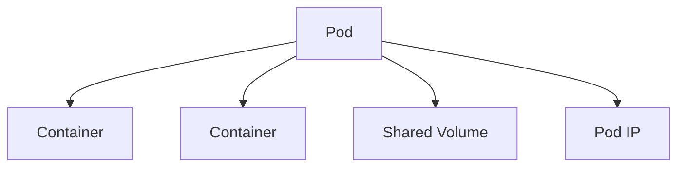
Na maioria das aplicações:
```text
1 Pod = 1 container principal
```
Mas sidecars também são comuns.
Exemplo:
```text
Pod
├── API container
└── Logging sidecar
```
***
# 10. Containers
O container é o processo efetivamente executado dentro do Pod.
```text
Cluster
└── Node
    └── Pod
        └── Container
```
Kubernetes não executa containers diretamente. Ele executa Pods, e os Pods contêm containers.
***
# 11. Labels e Selectors
Labels identificam recursos.
```yaml
metadata:
  labels:
    app: api
    environment: production
```
Selectors permitem encontrar recursos com determinadas labels.
```yaml
selector:
  matchLabels:
    app: api
```
Essa relação é fundamental para entender Services, Deployments, NetworkPolicies e outros recursos.
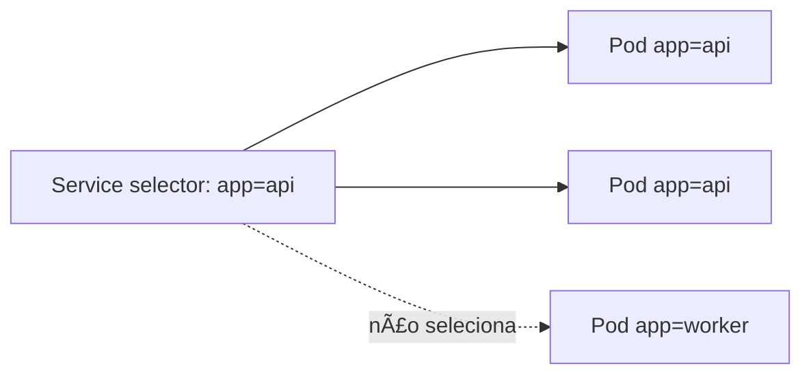
***
# 12. Service
Pod IPs são efêmeros. Um Service fornece um endereço estável para acessar um conjunto de Pods.
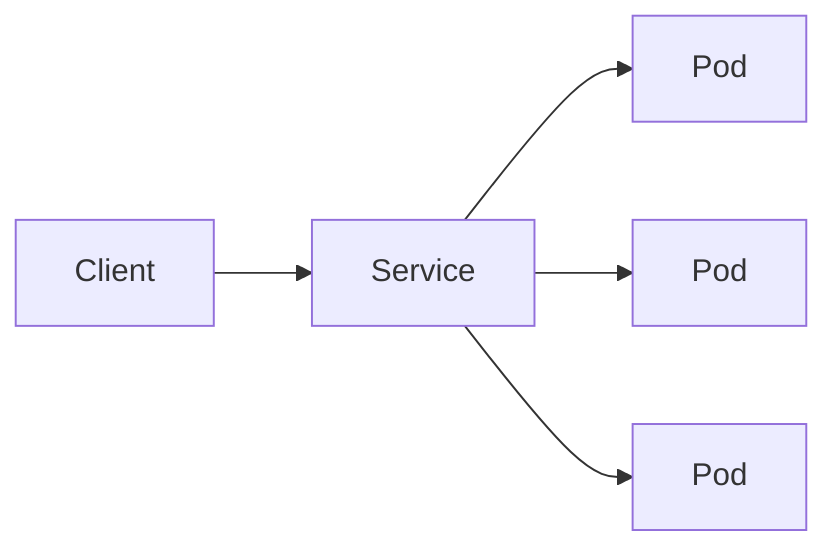
Tipos comuns:
- ClusterIP
- NodePort
- LoadBalancer
- ExternalName
O Service usa selectors para descobrir quais Pods devem receber tráfego.
***
# 13. Ingress e Gateway API
Ingress e Gateway API tratam do tráfego HTTP/HTTPS que entra no cluster.
Uma visão simplificada:
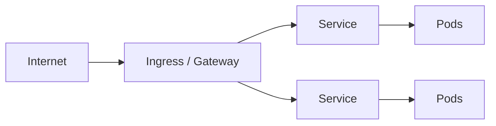
A diferença conceitual importante:
```text
Service
    -> expõe uma aplicação dentro/através do cluster
Ingress / Gateway
    -> define como requisições externas chegam aos Services
```
Gateway API é a evolução mais flexível do modelo de Ingress.
***
# 14. ConfigMap
ConfigMap armazena configurações não sensíveis.
Exemplo:
```yaml
apiVersion: v1
kind: ConfigMap
metadata:
  name: api-config
data:
  ASPNETCORE_ENVIRONMENT: Production
```
Pode ser consumido por um Pod como:
- variável de ambiente;
- arquivo montado.
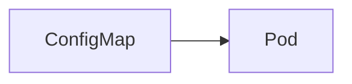
***
# 15. Secret
Secret é utilizado para informações sensíveis, como:
- passwords;
- tokens;
- connection strings;
- certificados.
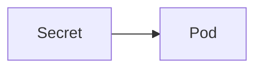
Importante:
> Secret não deve ser interpretado automaticamente como um cofre criptográfico completo. A proteção real depende também da configuração do cluster, especialmente do armazenamento e controle de acesso.
***
### Cofres externos

Um Secret Kubernetes fica armazenado no cluster; Base64 é codificação, não criptografia. Restrinja o acesso com RBAC e configure criptografia em repouso. Para manter a origem do valor fora do cluster, instale um operador ou driver e configure sua identidade e permissões no provedor.

#### External Secrets Operator

O [External Secrets Operator](https://external-secrets.io/latest/) lê um cofre externo e sincroniza os valores para um Secret Kubernetes. É adequado quando a aplicação já consome Secrets por variáveis de ambiente ou volumes. Requer o operador, um SecretStore/ClusterSecretStore configurado e permissões para ler o provedor e criar/atualizar o Secret.

```yaml
apiVersion: external-secrets.io/v1
kind: ExternalSecret
metadata:
  name: payments-db
  namespace: platform
spec:
  refreshInterval: 1h
  secretStoreRef:
    name: production-secrets
    kind: ClusterSecretStore
  target:
    name: payments-db
    creationPolicy: Owner
  data:
    - secretKey: password
      remoteRef:
        key: apps/payments
        property: database-password
```

O exemplo pressupõe store, identidade do operador e chave remota configurados. O ExternalSecret cria ou atualiza o Secret `payments-db`, que um [Deployment](#deployment) pode consumir.

#### Secrets Store CSI Driver

O [Secrets Store CSI Driver](https://secrets-store-csi-driver.sigs.k8s.io/) monta valores do provedor como arquivos no Pod usando um SecretProviderClass. É adequado quando a aplicação lê arquivos e a política busca evitar uma cópia Secret no API server. Requer driver e plugin do provedor, identidade do Pod autorizada e configuração de montagem.

```yaml
apiVersion: secrets-store.csi.x-k8s.io/v1
kind: SecretProviderClass
metadata:
  name: payments-db
  namespace: platform
spec:
  provider: vault
  parameters:
    roleName: payments
    objects: |
      - objectName: database-password
        secretPath: secret/data/apps/payments
        secretKey: password
---
apiVersion: apps/v1
kind: Deployment
metadata:
  name: payments
  namespace: platform
spec:
  selector:
    matchLabels: { app: payments }
  template:
    metadata:
      labels: { app: payments }
    spec:
      containers:
        - name: app
          image: example/payments:1.0
          volumeMounts:
            - name: external-secrets
              mountPath: /mnt/secrets-store
              readOnly: true
      volumes:
        - name: external-secrets
          csi:
            driver: secrets-store.csi.k8s.io
            readOnly: true
            volumeAttributes:
              secretProviderClass: payments-db
```

O trecho Vault requer o plugin Vault e autenticação configurada. Sincronizar arquivos CSI para Secrets Kubernetes é opcional e cria cópia no cluster; habilite somente se necessário. Consulte a documentação do driver sobre suporte e rotação para a versão instalada.

**Escolha:** Secret nativo é a integração mais simples; ESO sincroniza cofre externo para o modelo Secret existente; CSI monta arquivos sem criar essa cópia por padrão. Nenhuma opção substitui RBAC mínimo, rotação e criptografia em repouso.

Referências: [Secrets no Kubernetes](https://kubernetes.io/docs/concepts/configuration/secret/), [criptografia em repouso](https://kubernetes.io/docs/tasks/administer-cluster/encrypt-data/), [API ExternalSecret](https://external-secrets.io/latest/api/externalsecret/) e [uso do CSI Driver](https://secrets-store-csi-driver.sigs.k8s.io/getting-started/usage).

# 16. Storage
Storage permite persistir dados além do ciclo de vida de um Pod.
Os principais conceitos são:
```text
Pod
 |
 v
PVC
 |
 v
PV
 |
 v
Storage
```
***
# 17. PersistentVolumeClaim
PVC é uma solicitação de armazenamento feita pela aplicação.
```yaml
apiVersion: v1
kind: PersistentVolumeClaim
metadata:
  name: postgres-data
spec:
  accessModes:
    - ReadWriteOnce
  resources:
    requests:
      storage: 20Gi
```
O Pod utiliza o PVC.
***
# 18. PersistentVolume
PV representa o armazenamento disponibilizado para o cluster.
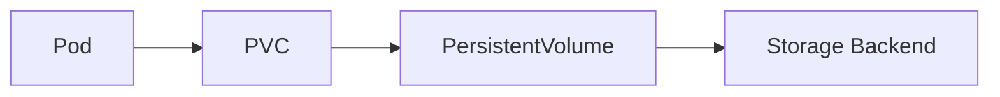
***
# 19. StorageClass
StorageClass define como volumes podem ser provisionados.
```text
PVC
 |
 v
StorageClass
 |
 v
Dynamic Provisioning
 |
 v
PV
```
Isso permite que o Kubernetes crie volumes dinamicamente conforme as necessidades da aplicação.
***
# 20. StatefulSet
StatefulSet é utilizado para workloads que precisam de identidade e/ou armazenamento persistente associado às réplicas.
Exemplo:
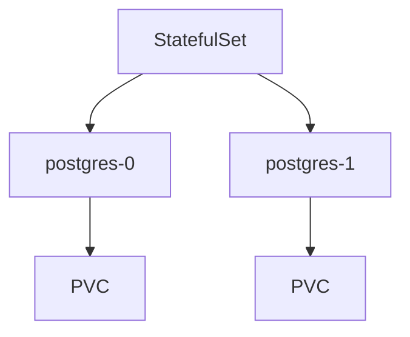
Diferentemente de um Deployment, os Pods possuem identidade previsível.
Exemplo:
```text
postgres-0
postgres-1
postgres-2
```
É comum em:
- bancos;
- sistemas distribuídos;
- Kafka;
- etcd;
- outras aplicações stateful.
***
# 21. DaemonSet
DaemonSet garante que um Pod seja executado em cada Node elegível.
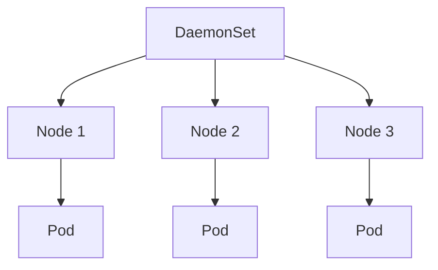
Casos comuns:
- agentes de logging;
- monitoramento;
- networking;
- segurança.
***
# 22. Job e CronJob
Job representa uma tarefa que precisa terminar.
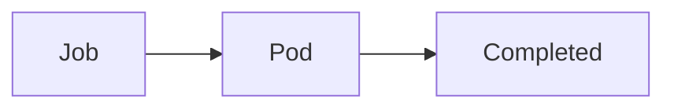
Exemplos:
- migrations;
- processamento batch;
- importação de dados.
CronJob executa Jobs em um horário definido.
```text
CronJob
   |
   +-- Job
   |    └── Pod
   |
   +-- Job
        └── Pod
```
***
# 23. Requests e Limits
Definem recursos de CPU e memória.
```yaml
resources:
  requests:
    cpu: "250m"
    memory: "256Mi"
  limits:
    cpu: "500m"
    memory: "512Mi"
```
### Requests
Quantidade usada pelo Scheduler para decidir onde colocar o Pod.
### Limits
Limite máximo permitido para o container.
```text
Pod
 |
 +-- requests -> planejamento/scheduling
 |
 +-- limits   -> limite de execução
```
***
# 24. Scheduling
O Scheduler decide em qual Node um Pod será executado.
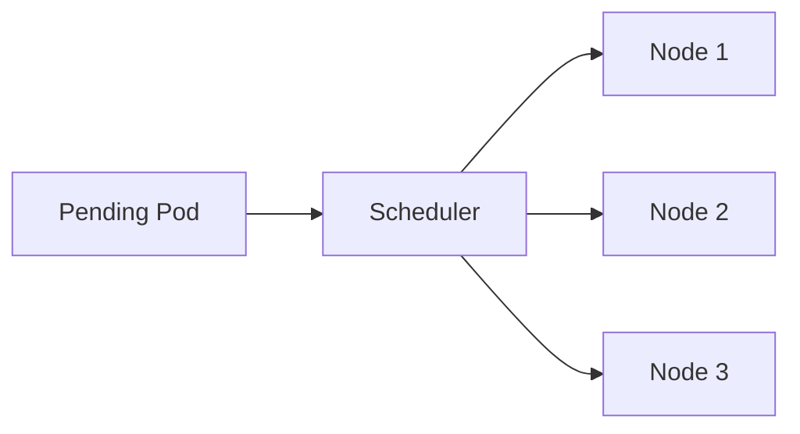
A decisão pode considerar:
- CPU;
- memória;
- requests;
- affinity;
- anti-affinity;
- taints;
- tolerations;
- topology;
- disponibilidade.
***
# 25. Node Affinity
Affinity permite expressar preferência ou requisito sobre onde um Pod deve ser executado.
Exemplo conceitual:
```text
Pod
 |
 +-- prefere Node com:
       disk=ssd
```
***
# 26. Pod Anti-Affinity
Anti-affinity permite evitar que Pods relacionados fiquem no mesmo local.
Exemplo:
```text
API replica 1 -> Node A
API replica 2 -> Node B
API replica 3 -> Node C
```
Isso aumenta a resiliência contra falha de um Node.
***
# 27. Taints e Tolerations
Taint pode impedir que Pods sejam agendados em determinado Node.
```text
Node
 |
 +-- taint: workload=gpu
```
Um Pod precisa de uma Toleration compatível para ser executado ali.
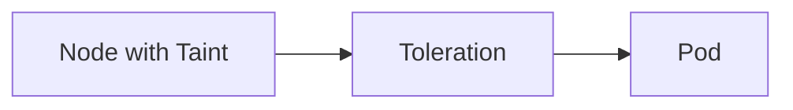
Use cases:
- Nodes de GPU;
- Nodes dedicados;
- workloads especiais.
***
# 28. Topology Spread Constraints
Permitem distribuir Pods entre domínios de falha.
Por exemplo:
```text
Zone A
  Pod
  Pod
Zone B
  Pod
  Pod
Zone C
  Pod
  Pod
```
Isso reduz o impacto de falhas de uma zona inteira.
***
# 29. Health Probes
Kubernetes possui três probes principais.
### Startup Probe
Verifica se a aplicação conseguiu iniciar.
### Readiness Probe
Indica se a aplicação está pronta para receber tráfego.
### Liveness Probe
Indica se o processo continua saudável.
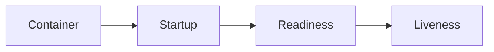
Conceitualmente:
```text
Startup
   ↓
Aplicação iniciou?
   ↓
Readiness
   ↓
Pode receber tráfego?
   ↓
Liveness
   ↓
Continua saudável?
```
***
# 30. Horizontal Pod Autoscaler — HPA
HPA altera a quantidade de réplicas de um workload.
```mermaid
flowchart LR
    M[Metrics] --> H[HPA]
    H --> D[Deployment]
    D --> P[Pods]
```
Exemplo:
```text
CPU baixa
    ↓
3 Pods
CPU alta
    ↓
6 Pods
```
HPA normalmente trabalha com métricas como:
- CPU;
- memória;
- métricas customizadas;
- métricas externas.
***
# 31. Vertical Pod Autoscaler — VPA
VPA ajusta requests/limits de recursos dos Pods.
```text
VPA
 |
 +-- CPU request
 +-- Memory request
```
Diferença principal:
```text
HPA -> mais/menos Pods
VPA -> mais/menos recursos por Pod
```
***
# 32. PodDisruptionBudget — PDB
PDB protege contra interrupções voluntárias.
Exemplo:
```yaml
minAvailable: 2
```
Se existem 3 réplicas, o Kubernetes deve evitar uma operação voluntária que deixe menos de 2 disponíveis.
PDB é útil durante:
- manutenção;
- drain de Nodes;
- upgrades;
- operações administrativas.
***
# 33. PriorityClass
Define prioridade relativa entre Pods.
Quando recursos são insuficientes, Pods de maior prioridade podem receber preferência.
```text
Critical workload
      ↓
High priority
Normal workload
      ↓
Normal priority
Batch workload
      ↓
Low priority
```
***
# 34. ServiceAccount
ServiceAccount representa uma identidade usada por Pods para interagir com a API do Kubernetes.
```mermaid
flowchart LR
    P[Pod] --> SA[ServiceAccount]
    SA --> RBAC[RBAC]
    RBAC --> API[Kubernetes API]
```
***
# 35. RBAC
RBAC controla quem pode executar quais ações sobre quais recursos.
Os principais objetos são:
- Role
- ClusterRole
- RoleBinding
- ClusterRoleBinding
Exemplo:
```text
ServiceAccount
      |
      v
RoleBinding
      |
      v
Role
      |
      v
Permissions
```
Exemplo conceitual:
```text
get pods
list pods
watch pods
```
***
# 36. SecurityContext
SecurityContext define aspectos de segurança de Pods e containers.
Pode controlar:
- usuário;
- grupo;
- capabilities;
- filesystem read-only;
- privilege escalation.
Exemplo:
```yaml
securityContext:
  runAsNonRoot: true
  allowPrivilegeEscalation: false
```
***
# 37. NetworkPolicy
NetworkPolicy controla quais Pods podem se comunicar.
```mermaid
flowchart LR
    API[API Pod] -->|allowed| DB[Database Pod]
    WEB[Web Pod] -->|allowed| API
    WEB -. blocked .-> DB
```
Isso permite implementar segmentação de rede dentro do cluster.
***
# 38. ResourceQuota
ResourceQuota limita o consumo total de recursos dentro de um Namespace.
Exemplo:
```text
Namespace dev
CPU total: 10 cores
Memory total: 20Gi
Pods: 50
```
***
# 39. LimitRange
LimitRange define valores padrão ou limites para recursos dentro de um Namespace.
Pode estabelecer:
- requests padrão;
- limits padrão;
- mínimo;
- máximo.
Diferença:
```text
ResourceQuota
    -> limite total do Namespace
LimitRange
    -> regras por recurso/Pod/container
```
***
# 40. CRD — Custom Resource Definition
CRD permite criar novos tipos de recursos Kubernetes.
Por exemplo:
```text
kind: Database
```
Depois de registrar um CRD, podemos criar:
```yaml
apiVersion: example.com/v1
kind: Database
metadata:
  name: postgres
spec:
  version: "17"
```
Isso permite estender a API do Kubernetes.
***
# 41. Controller
Controller observa recursos e tenta fazer o estado real convergir para o estado desejado.
```mermaid
flowchart LR
    D[Desired State] --> C[Controller]
    C --> A[Actual State]
    A --> C
```
Essa é uma das ideias fundamentais do Kubernetes.
Deployment, StatefulSet e muitos outros recursos funcionam através de controllers.
***
# 42. Operator
Operator combina:
- CRDs;
- Controllers;
- lógica específica de uma aplicação.
Por exemplo, um Operator pode saber como:
- criar um banco;
- configurar replicação;
- realizar backup;
- recuperar uma instância;
- fazer upgrade.
```text
Custom Resource
      |
      v
Operator
      |
      +-- Deployment
      +-- Service
      +-- PVC
      +-- Secret
```
***
# 43. Admission Controllers
Admission Controllers interceptam requisições à API antes que sejam persistidas.
Podem:
- validar;
- modificar;
- bloquear recursos.
Fluxo:
```mermaid
flowchart LR
    U[User] --> API[API Server]
    API --> AC[Admission]
    AC --> ETCD[(etcd)]
```
São usados para políticas de segurança e governança.
***
# 44. Helm
Helm é um gerenciador de pacotes para Kubernetes.
Um Chart agrupa:
- templates;
- values;
- manifests;
- configurações.
```text
Chart
├── templates/
├── values.yaml
└── Chart.yaml
```
Exemplo:
```bash
helm install my-api ./chart
```
Helm resolve principalmente o problema de **empacotamento e parametrização**.
***
# 45. Kustomize
Kustomize permite customizar manifests Kubernetes sem necessariamente utilizar templates.
Um padrão comum:
```text
base/
overlays/
├── dev/
├── staging/
└── prod/
```
***
# 46. Argo CD e GitOps
Argo CD implementa um modelo GitOps para Kubernetes.
A ideia:
```mermaid
flowchart LR
    G[Git] --> A[Argo CD]
    A --> K[Kubernetes Cluster]
```
O Git representa o estado desejado.
Argo CD compara:
```text
Git state
    vs
Cluster state
```
e trabalha para eliminar o drift.
***
# 47. Observabilidade
Observabilidade normalmente envolve:
- logs;
- métricas;
- traces;
- eventos.
```mermaid
flowchart TD
    A[Application]
    A --> L[Logs]
    A --> M[Metrics]
    A --> T[Traces]
    A --> E[Kubernetes Events]
    M --> HPA[HPA]
    L --> O[Observability Platform]
    M --> O
    T --> O
```
***
# 48. Como os conceitos se relacionam
A visão completa pode ser representada assim:
```mermaid
flowchart TD
    C[Cluster]
    C --> CP[Control Plane]
    C --> N[Worker Nodes]
    C --> NS[Namespaces]
    NS --> W[Workloads]
    W --> D[Deployment]
    W --> SS[StatefulSet]
    W --> DS[DaemonSet]
    W --> J[Job]
    W --> CJ[CronJob]
    D --> RS[ReplicaSet]
    RS --> P[Pods]
    SS --> SP[Stateful Pods]
    DS --> DP[Daemon Pods]
    J --> JP[Job Pods]
    CJ --> J
    P --> CT[Containers]
    S[Service] --> P
    I[Ingress / Gateway] --> S
    CM[ConfigMap] --> P
    SEC[Secret] --> P
    P --> PVC[PVC]
    PVC --> PV[PV]
    PV --> SC[StorageClass]
    HPA[HPA] --> D
    VPA[VPA] --> P
    PDB[PDB] --> D
    SA[ServiceAccount] --> RBAC[RBAC]
    RBAC --> P
    NP[NetworkPolicy] --> P
    SCH[Scheduler] --> N
    D --> SCH
```
***
# 49. Hierarquia mental recomendada
A melhor forma de estudar Kubernetes não é tratar todos os recursos como uma lista.
Pense primeiro nesta hierarquia:
```text
Cluster
│
├── Control Plane
│
├── Nodes
│   │
│   └── Pods
│       │
│       └── Containers
│
└── Namespaces
    │
    └── Workloads
        │
        ├── Deployment
        │   └── ReplicaSet
        │       └── Pods
        │
        ├── StatefulSet
        │   └── Pods
        │
        ├── DaemonSet
        │   └── Pods
        │
        └── Jobs
            └── Pods
```
Depois adicione os recursos que **se relacionam** com essa hierarquia:
```text
Service
    └── seleciona Pods
Ingress / Gateway
    └── direciona tráfego para Services
ConfigMap
    └── fornece configuração aos Pods
Secret
    └── fornece dados sensíveis aos Pods
PVC
    └── fornece armazenamento aos Pods
HPA
    └── controla escala de Workloads
PDB
    └── protege disponibilidade dos Pods
Scheduler
    └── decide em qual Node o Pod executará
RBAC
    └── controla permissões
NetworkPolicy
    └── controla comunicação entre Pods
```
***
# 50. Arquitetura de uma aplicação típica
Uma aplicação .NET poderia ser representada assim:
```mermaid
flowchart TD
    Internet --> Gateway
    Gateway --> APIService
    APIService --> APIPods
    APIPods --> ConfigMap
    APIPods --> Secret
    APIPods --> PVC
    HPA --> Deployment
    Deployment --> APIPods
    APIPods --> DatabaseService
    DatabaseService --> DatabasePods
    DatabasePods --> DatabasePVC
```
Uma estrutura mais realista:
```text
Cluster
│
├── Namespace: application
│   │
│   ├── Gateway / Ingress
│   │
│   ├── Service: API
│   │   └── Deployment
│   │       └── Pods
│   │           └── .NET containers
│   │
│   ├── ConfigMap
│   ├── Secret
│   ├── HPA
│   ├── PDB
│   └── ServiceAccount
│
└── Namespace: database
    │
    ├── Service
    ├── StatefulSet
    │   └── PostgreSQL Pods
    │
    └── PVC
```
***
# 51. Ordem recomendada para estudar
### Nível 1 — Estrutura
1. Cluster
2. Control Plane
3. Node
4. Namespace
5. Pod
6. Container
### Nível 2 — Workloads
7. Deployment
8. ReplicaSet
9. StatefulSet
10. DaemonSet
11. Job
12. CronJob
### Nível 3 — Comunicação
13. Labels
14. Selectors
15. Service
16. Ingress
17. Gateway API
### Nível 4 — Configuração e dados
18. ConfigMap
19. Secret
20. Volume
21. PVC
22. PV
23. StorageClass
### Nível 5 — Scheduling e recursos
24. Requests
25. Limits
26. Scheduler
27. Affinity
28. Anti-affinity
29. Taints
30. Tolerations
31. Topology Spread Constraints
### Nível 6 — Resiliência e escala
32. Probes
33. HPA
34. VPA
35. PDB
36. PriorityClass
### Nível 7 — Segurança
37. ServiceAccount
38. RBAC
39. SecurityContext
40. NetworkPolicy
41. ResourceQuota
42. LimitRange
### Nível 8 — Extensibilidade
43. CRD
44. Controller
45. Operator
46. Admission Controller
### Nível 9 — Deploy e operação
47. Helm
48. Kustomize
49. Argo CD
50. GitOps
51. Observabilidade
***
# 52. Resumo final
A principal visão mental deve ser:
```text
CLUSTER
│
├── CONTROL PLANE
│   ├── API Server
│   ├── Scheduler
│   ├── Controllers
│   └── etcd
│
├── NODES
│   └── PODS
│       └── CONTAINERS
│
└── NAMESPACES
    └── WORKLOADS
        ├── DEPLOYMENT
        │   └── REPLICASET
        │       └── PODS
        │
        ├── STATEFULSET
        │   └── PODS
        │
        ├── DAEMONSET
        │   └── PODS
        │
        └── JOB / CRONJOB
            └── PODS

RELACIONAMENTOS TRANSVERSAIS
SERVICE
    └── seleciona PODS
INGRESS / GATEWAY
    └── direciona para SERVICES
CONFIGMAP / SECRET
    └── configuram PODS
PVC / PV / STORAGECLASS
    └── fornecem STORAGE aos PODS
HPA / VPA / PDB
    └── controlam comportamento dos WORKLOADS
SCHEDULER
    └── coloca PODS em NODES
RBAC / SERVICEACCOUNT
    └── controlam permissões
NETWORKPOLICY
    └── controla comunicação
CRD / OPERATOR
    └── estendem o próprio Kubernetes
HELM / KUSTOMIZE / ARGO CD
    └── empacotam, configuram e entregam recursos
```
A regra mental mais importante é:
> **Cluster é o maior contexto. Nodes e Namespaces existem dentro dele. Workloads existem nos Namespaces e geram Pods. Pods executam Containers. Os demais recursos normalmente se relacionam com esses elementos, em vez de simplesmente ficarem abaixo deles em uma hierarquia.**

# Exemplos práticos e comparações

Os exemplos completos, traduzidos e com botão de cópia estão na seção **Exemplos práticos** da Wiki. Os manifests abaixo usam nomes/imagens ilustrativos; confira requisitos do controller e da StorageClass do seu cluster antes de aplicar.

## Deployment x StatefulSet x DaemonSet

Deployment é para réplicas intercambiáveis. StatefulSet dá identidade ordinal e pode criar um PVC por réplica; não replica dados nem torna a aplicação altamente disponível sozinho. DaemonSet executa em cada Node elegível. Use Job para tarefa finita e CronJob para criar Jobs por agenda. ReplicaSet normalmente é gerenciado por Deployment.

```yaml
apiVersion: apps/v1
kind: Deployment
metadata: { name: api }
spec:
  replicas: 3
  selector: { matchLabels: { app: api } }
  template:
    metadata: { labels: { app: api } }
    spec:
      containers: [{ name: api, image: example/api:1.0 }]
```

Referências: [Deployment](https://kubernetes.io/docs/concepts/workloads/controllers/deployment/), [StatefulSet](https://kubernetes.io/docs/concepts/workloads/controllers/statefulset/), [DaemonSet](https://kubernetes.io/docs/concepts/workloads/controllers/daemonset/) e [Jobs](https://kubernetes.io/docs/concepts/workloads/controllers/).

## Service, Ingress e Gateway API

Service cria um endereço estável e seleciona Pods por labels. Ingress/Gateway definem rotas externas para Services. Ingress requer controller; a API está congelada e Kubernetes recomenda considerar Gateway API para novos recursos de roteamento.

```yaml
apiVersion: v1
kind: Service
metadata: { name: web }
spec:
  selector: { app: web }
  ports: [{ port: 80, targetPort: 8080 }]
```

Referências: [Service](https://kubernetes.io/docs/concepts/services-networking/service/), [Ingress](https://kubernetes.io/docs/concepts/services-networking/ingress/) e [Gateway API](https://gateway-api.sigs.k8s.io/).

## Configuração, identidade e permissões

ConfigMap guarda configuração não sensível; Secret representa dado sensível, mas Base64 não é criptografia. ServiceAccount dá identidade ao Pod. Role/ClusterRole definem permissões; RoleBinding/ClusterRoleBinding associam sujeitos aos papéis.

```yaml
apiVersion: v1
kind: ConfigMap
metadata: { name: api-config }
data: { LOG_LEVEL: Information }
---
apiVersion: v1
kind: Secret
metadata: { name: api-credentials }
type: Opaque
stringData: { password: replace-me }
```

Use apenas credenciais fictícias em exemplos. Referências: [ConfigMap](https://kubernetes.io/docs/concepts/configuration/configmap/), [Secret](https://kubernetes.io/docs/concepts/configuration/secret/), [ServiceAccount](https://kubernetes.io/docs/concepts/security/service-accounts/) e [RBAC](https://kubernetes.io/docs/reference/access-authn-authz/rbac/).

## PVC, PV e StorageClass

Aplicações solicitam armazenamento com PVC. O cluster vincula a claim a um PV existente ou o provisiona dinamicamente conforme a StorageClass. Em geral, o usuário cria PVC; administradores e provisionadores gerenciam PVs. Volumes locais dependem de Node específico.

```yaml
apiVersion: v1
kind: PersistentVolumeClaim
metadata: { name: app-data }
spec:
  accessModes: [ReadWriteOnce]
  resources:
    requests: { storage: 5Gi }
```

Referências: [Persistent Volumes](https://kubernetes.io/docs/concepts/storage/persistent-volumes/), [StorageClass](https://kubernetes.io/docs/concepts/storage/storage-classes/) e [provisionamento dinâmico](https://kubernetes.io/docs/concepts/storage/dynamic-provisioning/).

## Escala, saúde e disponibilidade

HPA altera o número de réplicas com base em métricas; VPA recomenda ou altera requests/limits por Pod e costuma ser instalado à parte; PDB limita interrupções voluntárias. Requests/limits e probes são configurações do container/Pod, não recursos controladores.

```yaml
apiVersion: autoscaling/v2
kind: HorizontalPodAutoscaler
metadata: { name: api }
spec:
  scaleTargetRef: { apiVersion: apps/v1, kind: Deployment, name: api }
  minReplicas: 2
  maxReplicas: 8
  metrics:
    - type: Resource
      resource:
        name: cpu
        target: { type: Utilization, averageUtilization: 70 }
```

Referências: [HPA](https://kubernetes.io/docs/tasks/run-application/horizontal-pod-autoscale/), [probes](https://kubernetes.io/docs/concepts/workloads/pods/pod-lifecycle/#container-probes), [disrupções/PDB](https://kubernetes.io/docs/concepts/workloads/pods/disruptions/) e [VPA](https://github.com/kubernetes/autoscaler/tree/master/vertical-pod-autoscaler).

## Políticas e agendamento

NetworkPolicy seleciona Pods e depende de um plugin que implemente sua aplicação. ResourceQuota limita o consumo total do namespace; LimitRange estabelece defaults e limites por objeto. PriorityClass influencia a prioridade de scheduling; affinity, taints/tolerations e topology spread influenciam a colocação dos Pods.

```yaml
apiVersion: v1
kind: ResourceQuota
metadata: { name: team-budget }
spec:
  hard: { pods: "20", requests.cpu: "4", requests.memory: 8Gi }
```

Referências: [NetworkPolicy](https://kubernetes.io/docs/concepts/services-networking/network-policies/), [ResourceQuota](https://kubernetes.io/docs/concepts/policy/resource-quotas/), [LimitRange](https://kubernetes.io/docs/concepts/policy/limit-range/) e [agendamento](https://kubernetes.io/docs/concepts/scheduling-eviction/).

## Extensibilidade e entrega

CRD adiciona um tipo à API; o controller/operator implementa seu comportamento. Helm empacota templates, Kustomize compõe overlays e Argo CD reconcilia manifests do Git. São ferramentas com papéis diferentes, não substitutos do Deployment/StatefulSet.

```yaml
apiVersion: apiextensions.k8s.io/v1
kind: CustomResourceDefinition
metadata: { name: databases.example.com }
spec:
  group: example.com
  scope: Namespaced
  names: { plural: databases, singular: database, kind: Database }
  versions:
    - name: v1
      served: true
      storage: true
      schema:
        openAPIV3Schema:
          type: object
          properties:
            spec: { type: object }
```

Referências: [Custom Resources/CRD](https://kubernetes.io/docs/concepts/extend-kubernetes/api-extension/custom-resources/), [Helm](https://helm.sh/docs/), [Kustomize](https://kubectl.docs.kubernetes.io/references/kustomize/) e [Argo CD](https://argo-cd.readthedocs.io/).

## Namespace, Pod, ReplicaSet, labels e selectors

Namespace separa nomes e políticas; Pod é a unidade executável; ReplicaSet mantém Pods selecionados, mas normalmente deve ser gerenciado por Deployment. Labels são metadados e só têm efeito quando um selector as utiliza.

Cluster e Node aparecem no grafo, mas sua criação depende da distribuição e do provedor de infraestrutura; não existe um manifesto de aplicação portátil para criá-los em qualquer ambiente. Consulte a documentação do provedor e [Nodes](https://kubernetes.io/docs/concepts/architecture/nodes/).

```yaml
apiVersion: v1
kind: Namespace
metadata: { name: team-a }
---
apiVersion: apps/v1
kind: ReplicaSet
metadata:
  name: api-example
  namespace: team-a
spec:
  replicas: 2
  selector: { matchLabels: { app: api } }
  template:
    metadata: { labels: { app: api } }
    spec:
      containers: [{ name: api, image: example/api:1.0 }]
```

Referências: [Namespaces](https://kubernetes.io/docs/concepts/overview/working-with-objects/namespaces/), [Pods](https://kubernetes.io/docs/concepts/workloads/pods/), [ReplicaSets](https://kubernetes.io/docs/concepts/workloads/controllers/replicaset/) e [labels/selectors](https://kubernetes.io/docs/concepts/overview/working-with-objects/labels/).

## PriorityClass e regras de posicionamento

PriorityClass ordena prioridade relativa, não reserva capacidade. Affinity e topology spread guiam ou restringem posicionamento; tolerations permitem tolerar taints sem forçar um Node específico.

```yaml
apiVersion: scheduling.k8s.io/v1
kind: PriorityClass
metadata: { name: batch-low }
value: 1000
globalDefault: false
description: Low-priority batch workloads
```

Referências: [PriorityClass](https://kubernetes.io/docs/concepts/scheduling-eviction/pod-priority-preemption/), [Node affinity](https://kubernetes.io/docs/concepts/scheduling-eviction/assign-pod-node/) e [topology spread](https://kubernetes.io/docs/concepts/scheduling-eviction/topology-spread-constraints/).

## Comandos para empacotar e entregar

```bash
helm upgrade --install api ./chart --namespace team-a --create-namespace
kubectl apply -k ./overlays/dev
argocd app get api-team-a
```

O primeiro comando instala/atualiza um release; o segundo aplica uma overlay Kustomize; o terceiro consulta uma Application Argo CD já configurada. Revise alterações antes de sincronizar GitOps.

## Exemplos de criação de recursos

Use os exemplos como ponto de partida e ajuste nomes, imagens, classes de armazenamento, campos específicos do controlador e permissões ao seu cluster.

### [Cluster](/wiki#cluster)

```bash
kubectl config current-context
kubectl cluster-info
kubectl get nodes
```

### [Node](/wiki#worker-node)

```bash
kubectl get nodes -o wide
kubectl describe node <node-name>
```

### [Namespace](/wiki#namespace)

```yaml
apiVersion: v1
kind: Namespace
metadata:
  name: demo
```

### [Containers](/wiki#containers)

```yaml
apiVersion: v1
kind: Pod
metadata:
  name: app-with-container
spec:
  containers:
    - name: app
      image: nginx:1.27
```

### [Deployment](/wiki#deployment)

```yaml
apiVersion: apps/v1
kind: Deployment
metadata:
  name: api
spec:
  replicas: 3
  selector:
    matchLabels:
      app: api
  template:
    metadata:
      labels:
        app: api
    spec:
      containers:
        - name: api
          image: my-api:1.0
```

### [ReplicaSet](/wiki#replicaset)

```yaml
apiVersion: apps/v1
kind: ReplicaSet
metadata:
  name: api
spec:
  replicas: 2
  selector:
    matchLabels:
      app: api
  template:
    metadata:
      labels:
        app: api
    spec:
      containers:
        - name: api
          image: nginx:1.27
```

### [Pod](/wiki#pod)

```yaml
apiVersion: v1
kind: Pod
metadata:
  name: standalone
  labels:
    app: standalone
spec:
  containers:
    - name: app
      image: nginx:1.27
```

### [Service](/wiki#service)

```yaml
apiVersion: v1
kind: Service
metadata:
  name: web
spec:
  selector:
    app: web
  ports:
    - name: http
      port: 80
      targetPort: 8080
  type: ClusterIP
```

### [Ingress and Gateway API](/wiki#ingress-e-gateway-api)

```yaml
apiVersion: networking.k8s.io/v1
kind: Ingress
metadata:
  name: web
spec:
  ingressClassName: nginx
  rules:
    - host: web.example.test
      http:
        paths:
          - path: /
            pathType: Prefix
            backend:
              service:
                name: web
                port:
                  number: 80
```

```yaml
apiVersion: gateway.networking.k8s.io/v1
kind: Gateway
metadata:
  name: public-gateway
  namespace: demo
spec:
  gatewayClassName: example-gateway-class
  listeners:
    - name: http
      protocol: HTTP
      port: 80
      allowedRoutes:
        namespaces:
          from: Same
---
apiVersion: gateway.networking.k8s.io/v1
kind: HTTPRoute
metadata:
  name: web
  namespace: demo
spec:
  parentRefs:
    - name: public-gateway
  hostnames:
    - web.example.test
  rules:
    - backendRefs:
        - name: web
          port: 80
```

### [ConfigMap](/wiki#configmap)

```yaml
apiVersion: v1
kind: ConfigMap
metadata:
  name: api-config
data:
  ASPNETCORE_ENVIRONMENT: Production
```

### [Secret](/wiki#secret)

```yaml
apiVersion: external-secrets.io/v1
kind: ExternalSecret
metadata:
  name: payments-db
  namespace: platform
spec:
  refreshInterval: 1h
  secretStoreRef:
    name: production-secrets
    kind: ClusterSecretStore
  target:
    name: payments-db
    creationPolicy: Owner
  data:
    - secretKey: password
      remoteRef:
        key: apps/payments
        property: database-password
```

```yaml
apiVersion: secrets-store.csi.x-k8s.io/v1
kind: SecretProviderClass
metadata:
  name: payments-db
  namespace: platform
spec:
  provider: vault
  parameters:
    roleName: payments
    objects: |
      - objectName: database-password
        secretPath: secret/data/apps/payments
        secretKey: password
---
apiVersion: apps/v1
kind: Deployment
metadata:
  name: payments
  namespace: platform
spec:
  selector:
    matchLabels: { app: payments }
  template:
    metadata:
      labels: { app: payments }
    spec:
      containers:
        - name: app
          image: example/payments:1.0
          volumeMounts:
            - name: external-secrets
              mountPath: /mnt/secrets-store
              readOnly: true
      volumes:
        - name: external-secrets
          csi:
            driver: secrets-store.csi.k8s.io
            readOnly: true
            volumeAttributes:
              secretProviderClass: payments-db
```

### [Volume in a Pod](/wiki#storage)

```yaml
apiVersion: v1
kind: Pod
metadata:
  name: app-with-volume
spec:
  containers:
    - name: app
      image: nginx:1.27
      volumeMounts:
        - name: shared-data
          mountPath: /data
  volumes:
    - name: shared-data
      emptyDir: {}
```

### [PersistentVolumeClaim](/wiki#persistentvolumeclaim)

```yaml
apiVersion: v1
kind: PersistentVolumeClaim
metadata:
  name: postgres-data
spec:
  accessModes:
    - ReadWriteOnce
  resources:
    requests:
      storage: 20Gi
```

### [PersistentVolume](/wiki#persistentvolume)

```yaml
apiVersion: v1
kind: PersistentVolume
metadata:
  name: local-data
spec:
  capacity:
    storage: 5Gi
  accessModes:
    - ReadWriteOnce
  persistentVolumeReclaimPolicy: Retain
  hostPath:
    path: /mnt/data
```

### [StorageClass](/wiki#storageclass)

```yaml
apiVersion: storage.k8s.io/v1
kind: StorageClass
metadata:
  name: fast
provisioner: example.com.csi.driver
reclaimPolicy: Delete
volumeBindingMode: WaitForFirstConsumer
```

### [StatefulSet](/wiki#statefulset)

```yaml
apiVersion: v1
kind: Service
metadata:
  name: database
spec:
  clusterIP: None
  selector:
    app: database
  ports:
    - name: db
      port: 5432
      targetPort: 5432
---
apiVersion: apps/v1
kind: StatefulSet
metadata:
  name: database
spec:
  serviceName: database
  replicas: 2
  selector:
    matchLabels:
      app: database
  template:
    metadata:
      labels:
        app: database
    spec:
      containers:
        - name: postgres
          image: postgres:16
          ports:
            - containerPort: 5432
          volumeMounts:
            - name: data
              mountPath: /var/lib/postgresql/data
  volumeClaimTemplates:
    - metadata:
        name: data
      spec:
        accessModes: ["ReadWriteOnce"]
        resources:
          requests:
            storage: 5Gi
```

### [DaemonSet](/wiki#daemonset)

```yaml
apiVersion: apps/v1
kind: DaemonSet
metadata:
  name: node-agent
spec:
  selector:
    matchLabels:
      app: node-agent
  template:
    metadata:
      labels:
        app: node-agent
    spec:
      containers:
        - name: agent
          image: example/node-agent:1.0
```

### [Job and CronJob](/wiki#job-e-cronjob)

```yaml
apiVersion: batch/v1
kind: CronJob
metadata:
  name: cleanup
spec:
  schedule: "0 2 * * *"
  jobTemplate:
    spec:
      template:
        spec:
          restartPolicy: OnFailure
          containers:
            - name: cleanup
              image: busybox:1.36
              command: ["sh", "-c", "echo cleanup"]
```

```yaml
apiVersion: batch/v1
kind: Job
metadata:
  name: one-time-report
spec:
  backoffLimit: 2
  template:
    spec:
      restartPolicy: Never
      containers:
        - name: report
          image: busybox:1.36
          command: ["sh", "-c", "echo generate report"]
```

### [HorizontalPodAutoscaler](/wiki#horizontal-pod-autoscaler-hpa)

```yaml
apiVersion: autoscaling/v2
kind: HorizontalPodAutoscaler
metadata:
  name: web
spec:
  scaleTargetRef:
    apiVersion: apps/v1
    kind: Deployment
    name: web
  minReplicas: 2
  maxReplicas: 10
  metrics:
    - type: Resource
      resource:
        name: cpu
        target:
          type: Utilization
          averageUtilization: 70
```

### [VerticalPodAutoscaler](/wiki#vertical-pod-autoscaler-vpa)

```yaml
apiVersion: autoscaling.k8s.io/v1
kind: VerticalPodAutoscaler
metadata:
  name: web
spec:
  targetRef:
    apiVersion: apps/v1
    kind: Deployment
    name: web
  updatePolicy:
    updateMode: Off
```

### [PodDisruptionBudget](/wiki#poddisruptionbudget-pdb)

```yaml
minAvailable: 2
```

### [PriorityClass](/wiki#priorityclass)

```yaml
apiVersion: scheduling.k8s.io/v1
kind: PriorityClass
metadata:
  name: high-priority
value: 100000
globalDefault: false
description: "Priority for latency-sensitive workloads"
```

### [ServiceAccount](/wiki#serviceaccount)

```yaml
apiVersion: v1
kind: ServiceAccount
metadata:
  name: app-reader
  namespace: demo
```

### [RBAC](/wiki#rbac)

```yaml
apiVersion: rbac.authorization.k8s.io/v1
kind: Role
metadata:
  name: pod-reader
  namespace: demo
rules:
  - apiGroups: [""]
    resources: ["pods"]
    verbs: ["get", "list", "watch"]
---
apiVersion: rbac.authorization.k8s.io/v1
kind: RoleBinding
metadata:
  name: app-pod-reader
  namespace: demo
subjects:
  - kind: ServiceAccount
    name: app-reader
    namespace: demo
roleRef:
  apiGroup: rbac.authorization.k8s.io
  kind: Role
  name: pod-reader
---
apiVersion: rbac.authorization.k8s.io/v1
kind: ClusterRole
metadata:
  name: node-reader
rules:
  - apiGroups: [""]
    resources: ["nodes"]
    verbs: ["get", "list", "watch"]
---
apiVersion: rbac.authorization.k8s.io/v1
kind: ClusterRoleBinding
metadata:
  name: app-node-reader
subjects:
  - kind: ServiceAccount
    name: app-reader
    namespace: demo
roleRef:
  apiGroup: rbac.authorization.k8s.io
  kind: ClusterRole
  name: node-reader
```

### [NetworkPolicy](/wiki#networkpolicy)

```yaml
apiVersion: networking.k8s.io/v1
kind: NetworkPolicy
metadata:
  name: allow-web
  namespace: demo
spec:
  podSelector:
    matchLabels:
      app: web
  policyTypes: [Ingress]
  ingress:
    - from:
        - podSelector:
            matchLabels:
              app: frontend
      ports:
        - protocol: TCP
          port: 8080
```

### [ResourceQuota](/wiki#resourcequota)

```yaml
apiVersion: v1
kind: ResourceQuota
metadata:
  name: compute-budget
  namespace: demo
spec:
  hard:
    requests.cpu: "4"
    requests.memory: 8Gi
    limits.cpu: "8"
    limits.memory: 16Gi
    pods: "20"
```

### [LimitRange](/wiki#limitrange)

```yaml
apiVersion: v1
kind: LimitRange
metadata:
  name: container-defaults
  namespace: demo
spec:
  limits:
    - type: Container
      defaultRequest:
        cpu: 100m
        memory: 128Mi
      default:
        cpu: 500m
        memory: 512Mi
```

### [CustomResourceDefinition](/wiki#crd-custom-resource-definition)

```yaml
apiVersion: example.com/v1
kind: Database
metadata:
  name: postgres
spec:
  version: "17"
```

## Controladores e recursos que eles criam

- [Deployment → ReplicaSet → Pod](/wiki#deployment)

```mermaid
flowchart LR
    D[Deployment] --> RS[ReplicaSet] --> P[Pods]
```

- [CronJob → Job → Pod](/wiki#job-e-cronjob)

```mermaid
flowchart LR
    C[CronJob] --> J[Jobs] --> P[Pods]
```

- [StatefulSet → Pod + PVC por réplica](/wiki#statefulset)

```mermaid
flowchart LR
    S[StatefulSet] --> P[Pods] --> PVC[PersistentVolumeClaims]
```

- [DaemonSet → um Pod em cada Node elegível](/wiki#daemonset)

```mermaid
flowchart LR
    D[DaemonSet] --> P[Pod per eligible Node]
```
